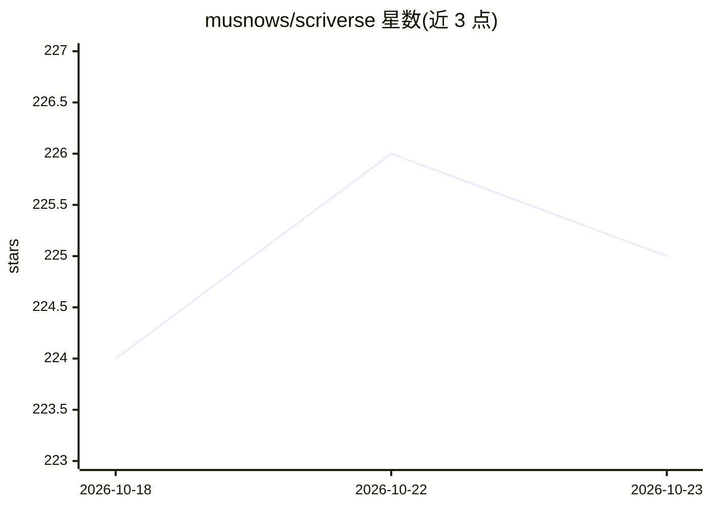

# musnows/scriverse

⭐ 225 · TypeScript · AGPL-3.0 · 推送 2026-10-17 · [GitHub](https://github.com/musnows/scriverse) · [官网](https://scriverse.top) · 个人维护 · 中文 README

**面向长篇小说的本地 AI 创作工作台（自部署 Web 应用）**

基于 Node.js 22.5+/Express/SQLite 的自托管 Web 应用，把正文分卷章节编辑、设定库、组织、时间线、人物关系、大纲伏笔与 AI 辅助集中在同一项目。AI 部分包括可引用章节行与设定上下文的创作助手，以及结构/角色/时间线/关系/一致性分析任务；供应商配置兼容 OpenAI Chat Completions 与 Anthropic Messages 协议。提供 npm CLI、Docker 镜像（amd64/arm64）与应用内多用户系统，数据存于本地 SQLite，AI 密钥加密存储。当前为 MVP，接口与数据结构可能调整。

## 筛选速览

| 维度 | 判定 | 备注 |
|---|---|---|
| AI 角色 | `ai-native` | 本体是模型或模型工具 |
| 许可风险 | `viral` | AGPL-3.0 |
| 部署形态 | `library` | 以包/库形式分发 |
| 模型依赖 | — | README 未给出锁定关系 |
| 硬件要求 | — | 无带数字的原话,不猜 |
| 安装摩擦 | `low` | 无编译、无系统依赖或容器化 |
| 成熟度 | — | 结构信号不足 |

## 能力要点

- 正文/设定/时间线/人物关系/伏笔与 AI 辅助一体化项目管理
- AI 任务覆盖角色抽取、时间线分析、关系分析与一致性检查
- 兼容 OpenAI Chat Completions 与 Anthropic Messages 协议，可配置并发与 RPM
- AI 供应商密钥加密存储，导出不含密钥；提供 Docker 镜像与 CLI

## 适用场景

- 管理大体量、设定密集的长篇小说工程
- 借助 AI 做角色抽取、关系分析与设定一致性检查
- 在写作时引用章节行与设定上下文生成内容

## 场景标签

`AI 写作` `知识库管理` · 领域:内容生成

## 证据(README 行号)

> L17:  叙界是一个面向长篇小说的本地 AI 创作工作台。它把正文、分卷、角色、组织、世界设定、时间线、人物关系、大纲伏笔和 AI 辅助集中在同一个项目中，适合管理大体量、设定密集的小说工程。
> L30: - AI 创作助手：支持 Markdown 和流式输出，可引用章节行、附加角色与设定上下文。
> L31: - AI 任务：结构分析、章节分析、角色抽取、时间线分析、关系分析和一致性检查。

## 星数曲线

2026-10-18 224 → 2026-10-23 225（+1）

---
*卡片 v1 · prompt 1.4 · 生成 2026-10-22 · 置信度 high · 依据 README sha `d263b7acf544` · [字段定义](../../DATASET.md)*
