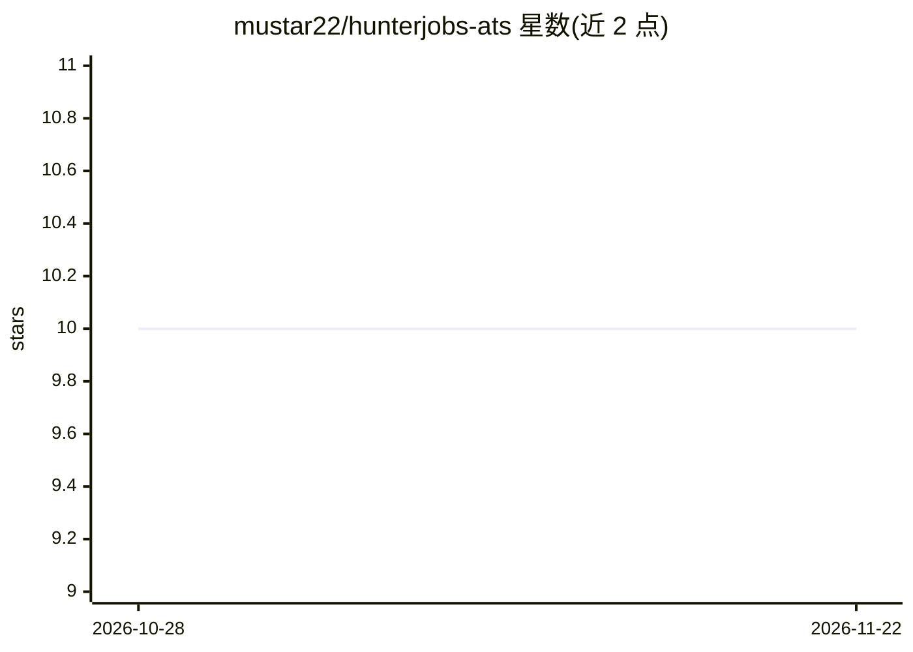

# mustar22/hunterjobs-ats

⭐ 10 · Python · Apache-2.0 · 推送 2026-11-21 · [GitHub](https://github.com/mustar22/hunterjobs-ats) · 个人维护

**求职者侧 ATS：本地三段 AI 管线筛选职位并起草联系策略**

运行在本地机器的 Python 应用：抓取 LinkedIn、YC、Hacker News、HeadHunter 四类职位源，用 LLM 按用户画像逐条给出 GOOD/MAYBE/BAD 判定，对值得投递的职位做公司研究与联系人发现，并有策略 Brain 聚合近 7 天数据生成定位报告、支持只读 SQL 对话。数据存于单文件 SQLite（WAL+FTS5+sqlite-vec），职位历史经嵌入向量做相似投递召回。明确声明非自动投递工具，不代发邮件；需自带 LLM API key，仅起步必需 GOOGLE_API_KEY。

## 筛选速览

| 维度 | 判定 | 备注 |
|---|---|---|
| AI 角色 | `ai-native` | 本体是模型或模型工具 |
| 许可风险 | `permissive` | Apache-2.0 |
| 部署形态 | `library` | 以包/库形式分发 |
| 模型依赖 | locked-api |  |
| 硬件要求 | — | 无带数字的原话,不猜 |
| 安装摩擦 | `low` | 无编译、无系统依赖或容器化 |
| 成熟度 | `idea` | |

## 能力要点

- 三段管线：抓取→按画像判定（关键词黑名单预过滤节省 LLM 调用）→公司研究与联系人发现
- 支持 Gemini/Gemma、Claude、OpenAI、OpenRouter、LM Studio 本地端点等多后端混配
- sqlite-vec 嵌入实现相似历史投递（RAG）召回，无需独立向量库
- 策略 Brain 可对职位表执行只读 SQL 查询并生成周报

## 适用场景

- 从多个职位板抓取并按个人画像过滤出短名单
- 为值得投递的职位找到可联系的真实人物与邮箱
- 定期复盘投递数据，分析定位与薪资现实性

## 场景标签

`RAG` `网页抓取` `数据分析` · 领域:效率与自动化

## 证据(README 行号)

> L20: A local Python app that reads job listings so you don't have to. It scrapes them, judges each one against your prof
> L55: |1|Scrape job boards, hard-reject obvious noise (keyword blacklist), then GOOD/MAYBE/BAD verdict against your profi
> L58: **Brain 2** is the strategist. Periodically aggregates your last 7 days of data and produces a brutal report on pos

## 星数曲线

2026-10-28 10 → 2026-11-22 10（+0）

---
*卡片 v1 · prompt 1.4 · 生成 2026-11-19 · 置信度 mid · 依据 README sha `be7ba888614e` · [字段定义](../../DATASET.md)*
