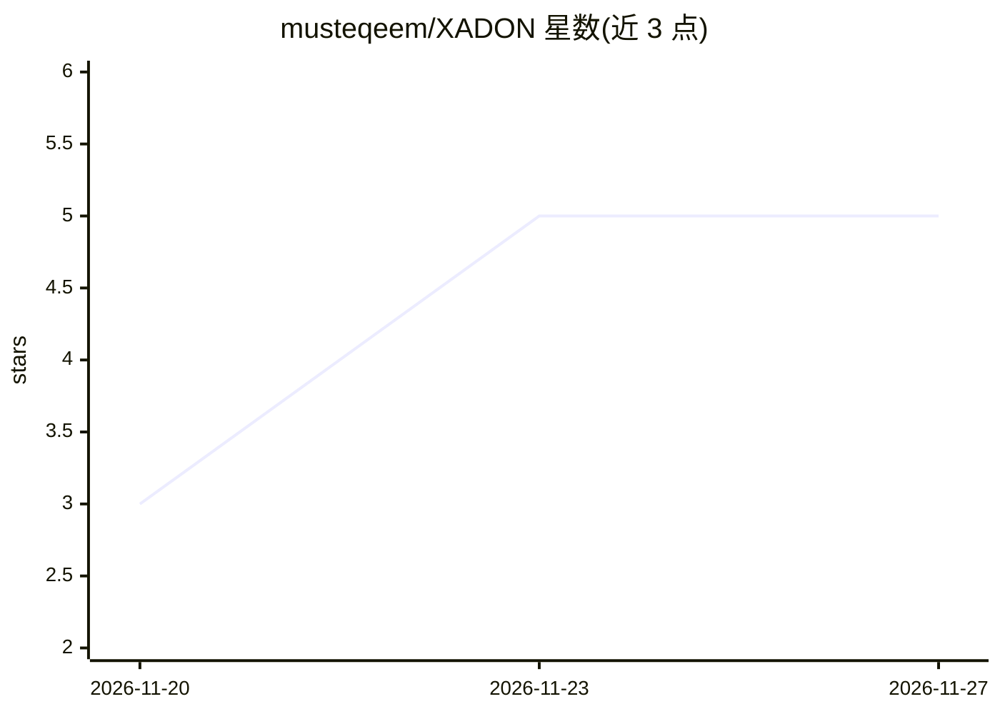

# musteqeem/XADON

⭐ 5 · JavaScript · 推送 2026-11-26 · [GitHub](https://github.com/musteqeem/XADON) · [官网](https://xadon.onrender.com) · 个人维护

**WhatsApp 群聊机器人：群管理、媒体、游戏与可选 AI 聊天**

基于 Node.js 20+ 与 @musteqeem/baileys（非官方 WhatsApp Web 协议）的 WhatsApp 机器人，源自 WAPLUS AI 基座。提供约 250 个命令：群管理（防链接、禁言、警告）、AI 聊天与搜索、贴纸与媒体转换、游戏与工具、网页配对面板。命令以模块形式加载，会话保存在磁盘并支持断线重连。README 提示使用非官方协议存在封号风险，部分命令需要 API key，支持 Termux/VPS/面板等多种部署方式。

## 筛选速览

| 维度 | 判定 | 备注 |
|---|---|---|
| AI 角色 | `ai-enhanced` | 去掉 AI 部分产品仍成立 |
| 许可风险 | `none` | — |
| 部署形态 | `library` | 以包/库形式分发 |
| 模型依赖 | — | README 未给出锁定关系 |
| 硬件要求 | — | 无带数字的原话,不猜 |
| 安装摩擦 | `low` | 无编译、无系统依赖或容器化 |
| 成熟度 | — | 结构信号不足 |

## 能力要点

- 约 250 个模块化命令，放入 src/commands/ 即可新增
- 配对码连接 WhatsApp，会话持久化并自动重连
- 内置本地配对与状态网页面板
- 群管理工具：防链接、反脏话、警告、欢迎语、投票等

## 适用场景

- 管理 WhatsApp 群组的成员与秩序
- 在聊天中使用贴纸、媒体转换、二维码等工具
- 为聊天配置可选的 AI 对话命令

## 场景标签

`聊天机器人` · 领域:对话与助手

## 证据(README 行号)

> L48: > **Real talk on account safety:** XADON connects through the unofficial WhatsApp Web protocol via **@musteqeem/bai
> L84: XADON is different. It's a proper Node.js WhatsApp bot that my guy **Musteqeem** keeps alive and updated. You link 
> L102: |🤖 **AI + search**|optional AI chat + web, news, dictionary, country info, lyrics lookup|

## 星数曲线

2026-11-20 3 → 2026-11-27 5（+2）

---
*卡片 v1 · prompt 1.4 · 生成 2026-11-21 · 置信度 high · 依据 README sha `1410a5228f21` · [字段定义](../../DATASET.md)*
