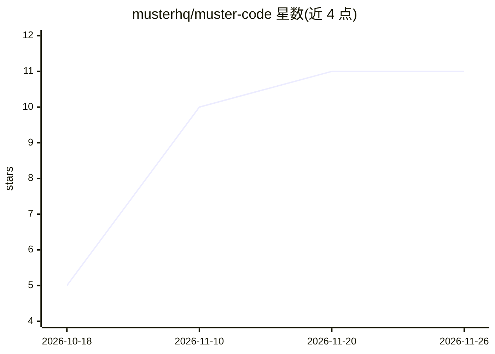

# musterhq/muster-code

⭐ 11 · TypeScript · MIT · 推送 2026-11-25 · [GitHub](https://github.com/musterhq/muster-code) · [官网](https://themuster.dev) · 组织维护

**带长期记忆的 AI 编码 Agent 桌面客户端，聚合多家代理与模型**

面向 macOS/Windows/Linux 的开源 AI 开发环境桌面应用（Electron）：在同一窗口运行 Codex、Claude Code、OpenCode 等编码 Agent 与任意 OpenAI 兼容路由及本地模型。核心机制包括基于 Hindsight 内存引擎的长期记忆（发送前可预览召回内容）、Docker 沙箱（默认无网络、内存/CPU/进程上限）、复用本机已有的登录态/API key/本地模型服务、实时 diff 的 Keep/Undo，以及终端、浏览器、git 面板、并行会话与自动化任务。Docker 为可选组件；macOS 构建未公证，首次打开需手动放行。

## 筛选速览

| 维度 | 判定 | 备注 |
|---|---|---|
| AI 角色 | `ai-ecosystem` | LLM/agent 周边工具 |
| 许可风险 | `permissive` | MIT |
| 部署形态 | `desktop` | 安装包/桌面程序 |
| 模型依赖 | local-ok | 支持本地模型 |
| 硬件要求 | — | 无带数字的原话,不猜 |
| 安装摩擦 | `low` | 无编译、无系统依赖或容器化 |
| 成熟度 | — | 结构信号不足 |

## 能力要点

- 长期记忆基于 Hindsight 引擎，发送前可预览并移除召回条目
- Docker 沙箱为每个会话提供无网络默认、限额资源的独立容器
- 自动发现本机已有登录态、API key、OpenAI 兼容网关与 Ollama/LM Studio 本地模型
- 实时 diff 逐块 Keep/Undo，集成终端、浏览器与 git 面板

## 适用场景

- 在一个窗口里并行管理多个编码 Agent 会话
- 让 Agent 在隔离沙箱中安全地改动我的代码库
- 给跨会话、跨项目的 Agent 工作记忆

## 场景标签

`编码 Agent` `Agent 记忆` · 领域:Agent 开发

## 证据(README 行号)

> L5: A desktop app for macOS, Windows and Linux where coding agents work in your folders, with long-term
> L8:  Works with Codex, Claude Code, Cursor, Gemini CLI, OpenCode and Grok, any OpenAI-compatible router
> L32: into one vendor's models. Muster Agent is an **agentic development client (ADC)** built the other way

## 星数曲线

2026-10-18 5 → 2026-11-26 11（+6）

---
*卡片 v1 · prompt 1.4 · 生成 2026-11-19 · 置信度 mid · 依据 README sha `c91df01da9e3` · [字段定义](../../DATASET.md)*
