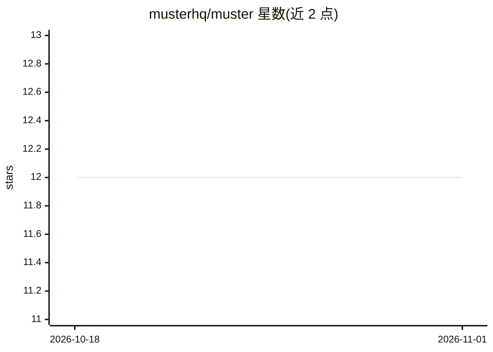

# musterhq/muster

⭐ 12 · TypeScript · MIT · 推送 2026-10-18 · [GitHub](https://github.com/musterhq/muster) · [官网](https://themuster.dev/) · 组织维护

**可审计的开源 AI agent harness：作用域内存、token 账本、评测门控**

TypeScript 编写的 AI agent 运行框架（harness），面向需要治理边界、自托管 agent 的开发者。核心机制：租户隔离的作用域内存、本地 token 浪费账本、行为学习需通过评测门控、MCP/插件策略，以及基于文件系统观察（而非 agent 自报）的变更审计——每次编辑产生带 sha256 哈希的可复现回执。另含事件溯源的 Agent Kanban 看板，模型选择经过九道有序门控且 fail-closed。通过 pnpm/npm CLI 运行终端聊天界面，要求 Node >=24。README 同时声明未完成的脱敏层等限制。

## 筛选速览

| 维度 | 判定 | 备注 |
|---|---|---|
| AI 角色 | `ai-ecosystem` | LLM/agent 周边工具 |
| 许可风险 | `permissive` | MIT |
| 部署形态 | `library` | 以包/库形式分发 |
| 模型依赖 | local-ok | 支持本地模型 |
| 硬件要求 | — | 无带数字的原话,不猜 |
| 安装摩擦 | `low` | 无编译、无系统依赖或容器化 |
| 成熟度 | — | 结构信号不足 |

## 能力要点

- workspace observer 从文件系统观察生成带 sha256 哈希链的编辑回执，可经 git apply 字节级重放
- token 账本与确定性的 Token Waste Index 基准（无模型调用）
- 作用域内存防止跨租户泄漏，运行时/提供商/模型绑定到 scope
- Agent Kanban 事件溯源看板，模型选择过九道门控且 fail-closed

## 适用场景

- 自托管运行需要向审计方交付变更凭据的 AI agent
- 多租户场景下防止 agent 内存泄漏与静默切换模型
- 对 agent 上下文渲染的 token 消耗做计量与优化

## 场景标签

`Agent 框架` `Agent 记忆` · 领域:Agent 开发

## 证据(README 行号)

> L3: **Muster is an open source AI agent harness for governed AI agents: scoped memory, a local token ledger, eval-gated 
> L7: Muster keeps those controls outside the model provider, so you can run a self-hosted AI agent on your own models, in

## 星数曲线

2026-10-18 12 → 2026-11-01 12（+0）

---
*卡片 v1 · prompt 1.4 · 生成 2026-11-01 · 置信度 mid · 依据 README sha `4fd3f6197cb3` · [字段定义](../../DATASET.md)*
