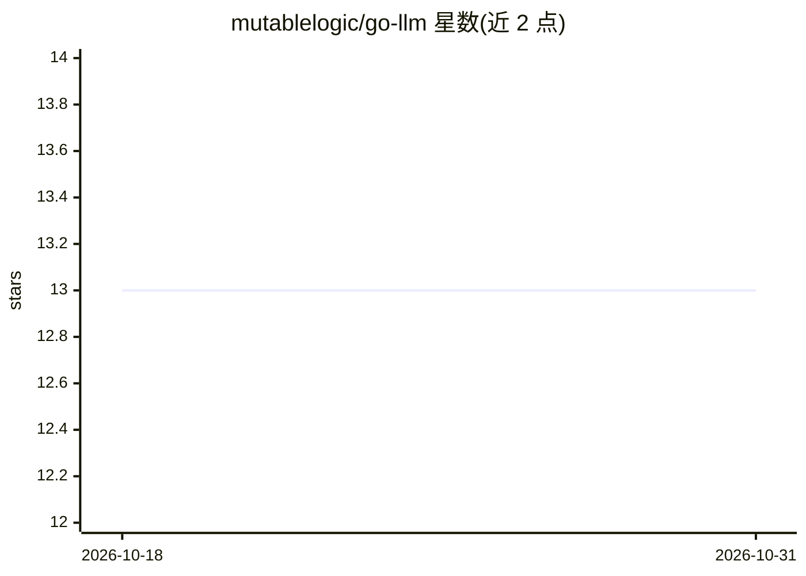

# mutablelogic/go-llm

⭐ 13 · Go · Apache-2.0 · 推送 2026-10-21 · [GitHub](https://github.com/mutablelogic/go-llm) · [官网](https://pkg.go.dev/github.com/mutablelogic/go-llm) · 个人维护

**Go 语言多供应商 LLM 工具与 SDK，统一 CLI/API/SDK 访问大模型**

面向 Go 开发者的多供应商 LLM 接入层：通过统一接口对接 Google Gemini、Anthropic Claude、Mistral，并以 CLI（终端 UI 聊天、ask、embedding）、REST API 服务器（SSE 流式）和 Go SDK 三种形式交付。支持有状态多轮会话（文件持久化）、工具调用框架（内置 Home Assistant/NewsAPI/WeatherAPI 示例）、MCP 服务器（stdio JSON-RPC 2.0）、以 Markdown+YAML 定义的版本化 Agent、JSON schema 结构化输出、扩展思考及 Telegram bot。各供应商需配置 API key。

## 筛选速览

| 维度 | 判定 | 备注 |
|---|---|---|
| AI 角色 | `ai-ecosystem` | LLM/agent 周边工具 |
| 许可风险 | `permissive` | Apache-2.0 |
| 部署形态 | `desktop` | 安装包/桌面程序 |
| 模型依赖 | locked-api |  |
| 硬件要求 | — | 无带数字的原话,不猜 |
| 安装摩擦 | `low` | 无编译、无系统依赖或容器化 |
| 成熟度 | — | 结构信号不足 |

## 能力要点

- 统一接口对接 Gemini、Anthropic Claude、Mistral 三家供应商
- CLI、REST API 服务器与 Go SDK 三种交付形式
- MCP 服务器（stdio JSON-RPC 2.0）暴露注册工具与 prompts
- 版本化 Agent 定义（Markdown+YAML front matter）与结构化输出

## 适用场景

- 在 Go 应用中统一接入多家 LLM 供应商
- 自建带会话管理与工具调用的 LLM REST 服务
- 通过终端或 Telegram 与多供应商模型对话

## 场景标签

`模型网关` `聊天机器人` · 领域:Agent 开发

## 证据(README 行号)

> L6: A multi-provider LLM tool and SDK for Go.
> L9: unified CLI, HTTP API server, or Go SDK. Supports stateless completion (`ask`), stateful

## 星数曲线

2026-10-18 13 → 2026-10-31 13（+0）

---
*卡片 v1 · prompt 1.4 · 生成 2026-10-31 · 置信度 high · 依据 README sha `8b5d0f74de2e` · [字段定义](../../DATASET.md)*
