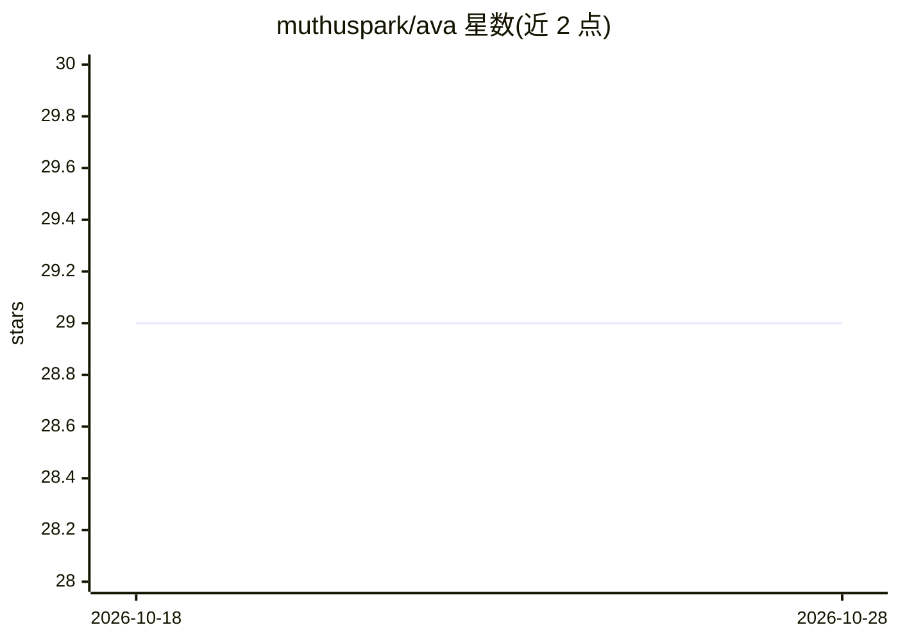

# muthuspark/ava

⭐ 29 · TypeScript · MIT · 推送 2026-07-22 · [GitHub](https://github.com/muthuspark/ava) · [官网](http://ava.muthu.co/) · 个人维护

**浏览器内全本地运行的隐私优先 AI 语音助手**

纯浏览器端运行的 AI 语音助手，基于 WebAssembly，无服务器依赖：语音识别用 Whisper tiny-en（经 Transformers.js），语言模型用 Gemma 3 270M（经 Wllama，llama.cpp 的 WASM 移植），语音合成用浏览器原生 SpeechSynthesis API，前端为 Vue 3 + TypeScript。语音活动检测用 Silero VAD 判断说话结束，LLM 输出按句切分以低延迟播报。要求 Chrome/Edge 90+ 并启用跨域隔离，首次加载约 220MB 模型，运行时约占 500MB-1GB 内存，目前仅 CPU（WASM SIMD）运行。

## 筛选速览

| 维度 | 判定 | 备注 |
|---|---|---|
| AI 角色 | `ai-native` | 本体是模型或模型工具 |
| 许可风险 | `permissive` | MIT |
| 部署形态 | `library` | 以包/库形式分发 |
| 模型依赖 | — | README 未给出锁定关系 |
| 硬件要求 | — | 无带数字的原话,不猜 |
| 安装摩擦 | `low` | 无编译、无系统依赖或容器化 |
| 成熟度 | — | 结构信号不足 |

## 能力要点

- 三阶段 WebAssembly 管线：VAD→Whisper 转录→Gemma 3 270M 推理→TTS
- 模型下载后零网络请求，全部处理在本地设备完成
- LLM 输出按句子边界切分，实现流式低延迟语音播报
- 提供在线演示与 MIT 许可

## 适用场景

- 在浏览器中与本地 AI 语音助手对话且不上传任何数据
- 体验纯 WebAssembly 端侧 LLM + 语音的完整管线
- 作为浏览器端本地 AI 应用的参考实现

## 场景标签

`语音 Agent` · 领域:对话与助手

## 证据(README 行号)

> L3: A privacy-first AI voice assistant that runs entirely in the browser using WebAssembly. Zero server dependencies—all
> L17: 2. **Language Model** — Transcribed text is passed to Gemma 3 270M via Wllama (llama.cpp WASM port). The `useConver
> L30: |Speech-to-Text|Whisper tiny-en (@huggingface/transformers)|~40MB|

## 星数曲线

2026-10-18 29 → 2026-10-28 29（+0）

---
*卡片 v1 · prompt 1.4 · 生成 2026-10-26 · 置信度 high · 依据 README sha `cd4c72a85b5c` · [字段定义](../../DATASET.md)*
