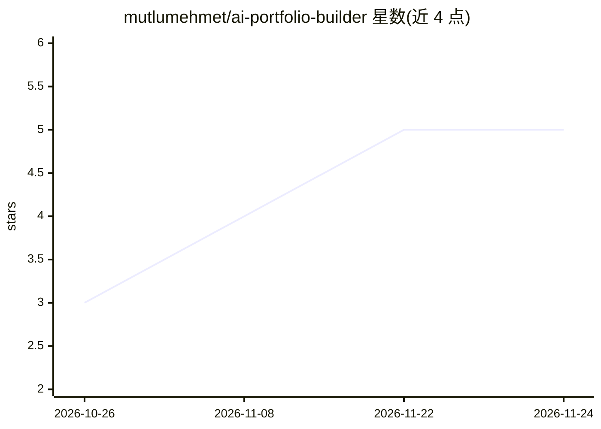

# mutlumehmet/ai-portfolio-builder

⭐ 5 · TypeScript · MIT · 推送 2026-11-21 · [GitHub](https://github.com/mutlumehmet/ai-portfolio-builder) · [官网](https://www.mehmetmutlu.dev) · 个人维护

**开发者/设计师作品集网站模板，含可选 AI 问答层**

面向开发者与设计师的开源作品集网站模板，基于 Next.js、Prisma、Postgres+pgvector 构建，支持从 LinkedIn、简历和 GitHub 导入草拟个人内容。可选 AI 层包括访客问答聊天、岗位匹配检查（贴入职位描述输出优势与差距）和远程 MCP 服务器；内容经 RAG 流程切块、嵌入并以余弦距离检索，仅基于站主自己的内容回答。AI 层各部分均有功能开关，全部关闭后是普通作品集网站。

## 筛选速览

| 维度 | 判定 | 备注 |
|---|---|---|
| AI 角色 | `ai-enhanced` | 去掉 AI 部分产品仍成立 |
| 许可风险 | `permissive` | MIT |
| 部署形态 | `library` | 以包/库形式分发 |
| 模型依赖 | local-ok | 支持本地模型 |
| 硬件要求 | — | 无带数字的原话,不猜 |
| 安装摩擦 | `low` | 无编译、无系统依赖或容器化 |
| 成熟度 | — | 结构信号不足 |

## 能力要点

- 可选 AI 层：聊天、岗位匹配检查、MCP 服务器三个功能各自带开关
- RAG 检索管线：rag:ingest 切块嵌入，仅以最近邻 chunk 作为回答上下文
- 三种初始化方式：Vercel 一键部署、npm run setup、交给编程 agent 执行
- 内置 /admin 管理面板、响应式布局、SEO、限流与安全措施

## 适用场景

- 为个人作品集添加基于自有内容的访客问答
- 招聘方贴入职位描述检查候选人与岗位的匹配度
- 让 Claude Code 等编程 agent 帮忙搭建和管理站点内容

## 场景标签

`RAG` `文档问答` · 领域:知识与检索

## 证据(README 行号)

> L5: **A complete portfolio website for developers and designers, plus an optional AI layer that answers questions about 
> L157: The AI layer is optional. Each part has its own feature flag; switch all three off and you have a plain portfolio.
> L108: |**Optional AI layer**|Switch the chat, the fit check and the MCP server off and you have a plain portfolio.|

## 星数曲线

2026-10-26 3 → 2026-11-24 5（+2）

---
*卡片 v1 · prompt 1.4 · 生成 2026-11-21 · 置信度 high · 依据 README sha `995e079f3f3d` · [字段定义](../../DATASET.md)*
