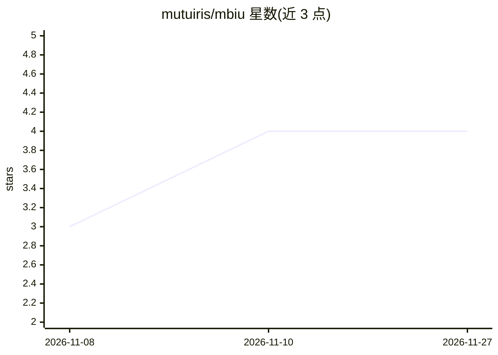

# mutuiris/mbiu

⭐ 4 · Python · 推送 2026-11-24 · [GitHub](https://github.com/mutuiris/mbiu) · [官网](https://mbiu-music.vercel.app) · 个人维护

**帮肯尼亚音乐人签约前逐条读懂音乐合同**

面向肯尼亚独立/早期音乐人的英文音乐合同解读工具：上传 PDF 后按条款拆分，与经审阅的标准合同模板库逐条对比，用通俗语言说明条款对钱、音乐、时间与接活自由的影响，并生成可打印的谈判清单。机制上采用混合检索（pgvector 向量 + BM25）、Gemini 主模型加 OpenAI 故障切换，模型输出仅作提案，全部经代码逐项校验（引用、数字、ID、禁用法律结论词）后才展示，失败则标为无法对比。明确声明不构成法律意见、不建议是否签约，不提供自由聊天。隐私上承诺服务器无状态、不存储任何合同。

## 筛选速览

| 维度 | 判定 | 备注 |
|---|---|---|
| AI 角色 | `ai-native` | 本体是模型或模型工具 |
| 许可风险 | `none` | — |
| 部署形态 | `None` |  |
| 模型依赖 | — | README 未给出锁定关系 |
| 硬件要求 | — | 无带数字的原话,不猜 |
| 安装摩擦 | `medium` | 含编译或系统依赖之一 |
| 成熟度 | `idea` | |

## 能力要点

- 逐条对比标准模板，输出 8 段式结果卡与四档中性标签
- 模型输出全部经代码校验：引用精确匹配、数字须出现在原文
- 隐私设计：合同不留存，AI 调用关闭存储，金丝雀测试验证
- 可下载黑白打印版报告与谈判清单

## 适用场景

- 签约前上传演出、品牌、发行或录音合同快速通读
- 拿到对比结果后向对方提出有针对性的修改问题
- 缺少标准保护条款时生成待补充事项清单

## 场景标签

`RAG` `文档问答` · 领域:知识与检索

## 证据(README 行号)

> L8: Mbiu helps independent and early-career Kenyan musicians understand English-language music contracts. An artist uplo
> L108: ### Why the AI's answer is never shown as-is
> L110: The model's output is treated as a **proposal**. Code checks it against what was actually sent to the model:

## 星数曲线

2026-11-08 3 → 2026-11-27 4（+1）

---
*卡片 v1 · prompt 1.4 · 生成 2026-11-21 · 置信度 high · 依据 README sha `846c61d8ea2f` · [字段定义](../../DATASET.md)*
