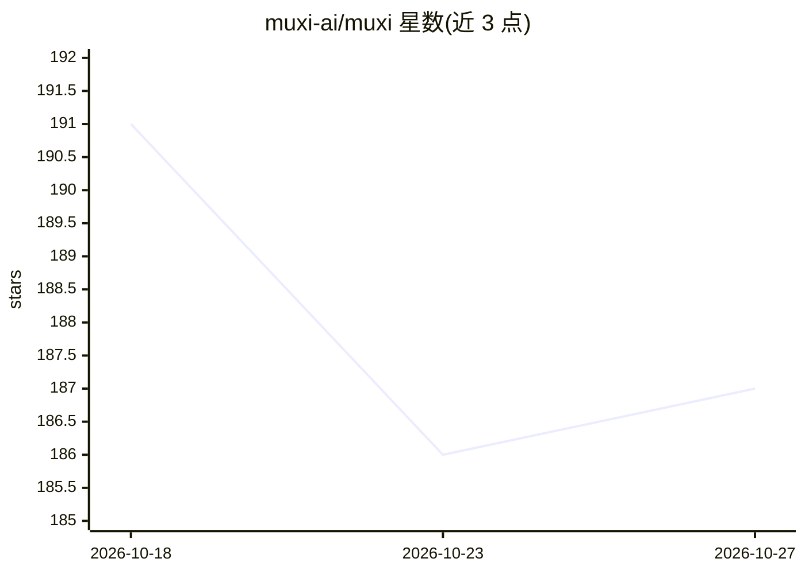

# muxi-ai/muxi

⭐ 187 · NOASSERTION · 推送 2026-09-28 · [GitHub](https://github.com/muxi-ai/muxi) · [官网](https://muxi.org/docs) · 个人维护

**自托管 AI 应用服务器：以声明式 Formation 部署与运行 agent 系统**

MUXI 是一个开源、可自托管的 AI 应用服务器，将 agent 作为原生原语，通过声明式 YAML Formation 文件（.afs）打包 agent、记忆、工具、知识、工作流与策略，用 muxi CLI 一条命令部署运行，类比 Docker 的 pull/deploy 工作流。内建编排（Overlord）、分层可审计记忆、分组 RBAC 与多租户隔离、Reasoning RAG、MCP 双向连接、A2A 协作、触发器与出站路由、可观测性与韧性机制，并支持云、本地或 OpenAI 兼容模型的分层选择，提供 12 种语言官方 SDK。面向平台构建者、内部工具构建者与开发者。许可为 Server/Runtime ELv2、CLI/SDK 等 Apache 2.0。

## 筛选速览

| 维度 | 判定 | 备注 |
|---|---|---|
| AI 角色 | `ai-ecosystem` | LLM/agent 周边工具 |
| 许可风险 | `none` | NOASSERTION |
| 部署形态 | `self-host` | docker 或自建部署 |
| 模型依赖 | — | README 未给出锁定关系 |
| 硬件要求 | — | 无带数字的原话,不猜 |
| 安装摩擦 | `low` | 无编译、无系统依赖或容器化 |
| 成熟度 | — | 结构信号不足 |

## 能力要点

- 声明式 .afs Formation 打包 agent/记忆/工具/工作流，muxi deploy 一条命令部署
- Overlord 编排：路由请求、匹配 SOP、任务分解与重规划
- 分组 RBAC、多租户隔离、分层事件溯源记忆与选择性遗忘
- 12 种语言官方 SDK，REST/SSE/MCP 多协议访问

## 适用场景

- 为 SaaS 产品部署带编排与多租户能力的 AI agent 后端
- 在组织内上线受 RBAC 与审计约束的内部 AI 系统
- 将 agent 暴露为 MCP 服务器供 Claude Desktop、Cursor 等客户端调用
- 替代手写 LangChain 编排代码，改用 YAML 配置部署

## 场景标签

`Agent 框架` `Agent 记忆` · 领域:Agent 开发

## 证据(README 行号)

> L21: MUXI (`/ˈmʌk.siː/`) is the **AI application server**. Not a framework. Not a wrapper. A complete, self-hosted serve
> L87: **MUXI is the infrastructure layer.** Frameworks help write agent logic. MUXI deploys and operates complete agent s

## 星数曲线

2026-10-18 191 → 2026-10-27 187（-4）

---
*卡片 v1 · prompt 1.4 · 生成 2026-10-22 · 置信度 mid · 依据 README sha `4a1a77a038f2` · [字段定义](../../DATASET.md)*
