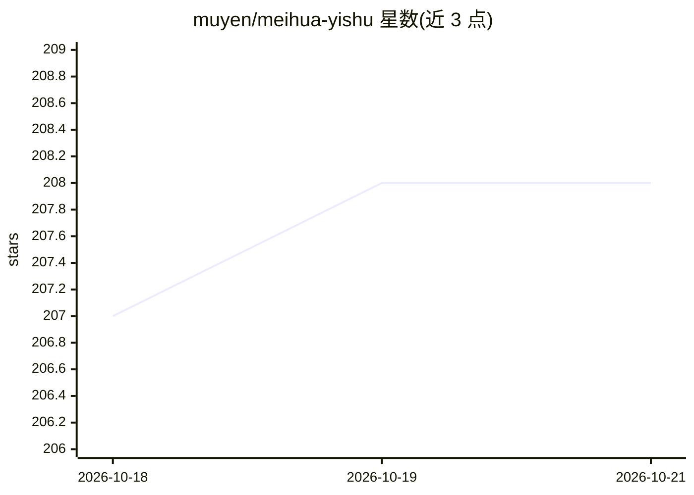

# muyen/meihua-yishu

⭐ 209 · Python · NOASSERTION · 推送 2026-08-09 · [GitHub](https://github.com/muyen/meihua-yishu) · [官网](https://iyarrow.xyz) · 个人维护 · 中文 README

**面向 Claude 等 LLM 的梅花易数占卜 AI 技能**

将传统梅花易数占卜体系封装为 AI Skill：提供 SKILL.md 主文档、references/ 参考资料与 Python 起卦脚本，可通过 Claude Code 一键或 git clone 安装到 skills 目录，也可将内容复制为 ChatGPT Custom GPT 或 Gemini Gem 的指令。功能覆盖 7 种起卦法（时间/数字/声音/颜色/方位等）、体用分析、互变错综四卦、通关化解、應期、策略建议、18 类专门占断与测字；另支持上传照片由 AI 分析外应。项目自述为决策思考框架而非预测，刻意不输出分数与吉凶百分比；另提供 iyarrow.xyz 网页版。

## 筛选速览

| 维度 | 判定 | 备注 |
|---|---|---|
| AI 角色 | `ai-native` | 本体是模型或模型工具 |
| 许可风险 | `none` | NOASSERTION |
| 部署形态 | `None` |  |
| 模型依赖 | locked-api |  |
| 硬件要求 | — | 无带数字的原话,不猜 |
| 安装摩擦 | `low` | 无编译、无系统依赖或容器化 |
| 成熟度 | — | 结构信号不足 |

## 能力要点

- 7 种起卦法（时间默认秒级精度、数字、声音、颜色、尺寸、方位）
- 体用双视角解读：五行生克与卦德，配合互/变/错/综四卦
- 18 类专门占断、十应外应分析与测字功能
- 支持照片上传由 AI 分析环境征兆

## 适用场景

- 在 Claude Code 中说'占卦'、'起卦'即触发占卜技能
- 把 SKILL.md 配置成 ChatGPT Custom GPT 或 Gemini Gem
- 用 Python 脚本本地起卦并输出结果
- 面对复杂选择时用卦象结构做多角度反思

## 场景标签

`提示工程` · 领域:Agent 开发

## 证据(README 行号)

> L7: Meihua Yishu (梅花易數 / Plum Blossom Numerology / Plum Blossom I Ching) is a traditional Chinese I Ching divination met
> L112: Once installed, mention divination keywords like "占卦", "起卦", or "meihua" — the skill will activate automatically.

## 星数曲线

2026-10-18 207 → 2026-10-21 208（+1）

---
*卡片 v1 · prompt 1.4 · 生成 2026-10-22 · 置信度 high · 依据 README sha `63391b36c32d` · [字段定义](../../DATASET.md)*
