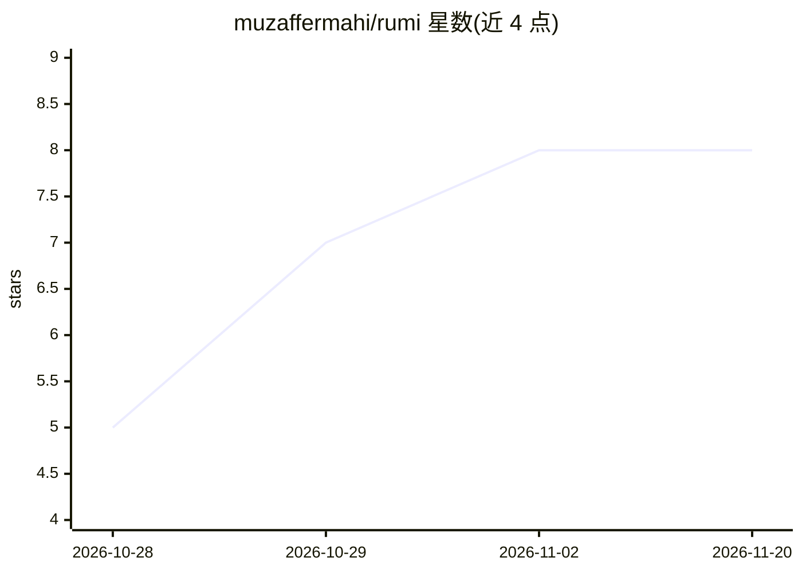

# muzaffermahi/rumi

⭐ 8 · JavaScript · MIT · 推送 2026-11-01 · [GitHub](https://github.com/muzaffermahi/rumi) · 个人维护

**本地优先写作工作区：把段落委托给 AI 代理并在边栏取回结果**

基于 Pi 构建的写作工作区，用户在单个文档中写作，选中任意段落后用 Ctrl+Enter 委托给后台代理执行研究、改写、思考或构建任务，结果以建议形式出现在段落旁边的边栏，可通过逐词 diff 替换原文。支持多任务并行、每任务会话、版本历史与 Markdown 导入导出。自带 Node 运行时，无需账号与遥测，浏览器中打开，模型通过 API key、已有订阅或本地运行时接入。

## 筛选速览

| 维度 | 判定 | 备注 |
|---|---|---|
| AI 角色 | `ai-native` | 本体是模型或模型工具 |
| 许可风险 | `permissive` | MIT |
| 部署形态 | `None` |  |
| 模型依赖 | local-ok | 支持本地模型 |
| 硬件要求 | — | 无带数字的原话,不猜 |
| 安装摩擦 | `low` | 无编译、无系统依赖或容器化 |
| 成熟度 | — | 结构信号不足 |

## 能力要点

- 选中段落一键委托，结果带逐词 diff，改动可一键撤销
- Research 任务免 API key 联网搜索并引用来源
- Build 任务可编辑文件与执行命令，带检查点与回滚
- 支持 Ollama/LM Studio 等本地模型，文档仅发给所选模型

## 适用场景

- 写作时不中断思路，让代理并行处理段落级研究或改写
- 在项目文件夹中委托代理修改代码并审查 diff
- 本地模型环境下离线使用 AI 写作助手

## 场景标签

`AI 写作` `推理引擎` `AI 助手` · 领域:对话与助手

## 证据(README 行号)

> L5: A writing workspace where you hand any passage to an AI worker with one keystroke, keep writing,
> L19: **Rumi turns this around.** You stay in one document: your plan, your argument, your notes, whatever you're thinkin
> L74: - **An API key** from Anthropic (Claude), OpenAI, OpenRouter, Google and many more. You pay the provider for what y

## 星数曲线

2026-10-28 5 → 2026-11-20 8（+3）

---
*卡片 v1 · prompt 1.4 · 生成 2026-11-20 · 置信度 high · 依据 README sha `4f2e3a02c16b` · [字段定义](../../DATASET.md)*
