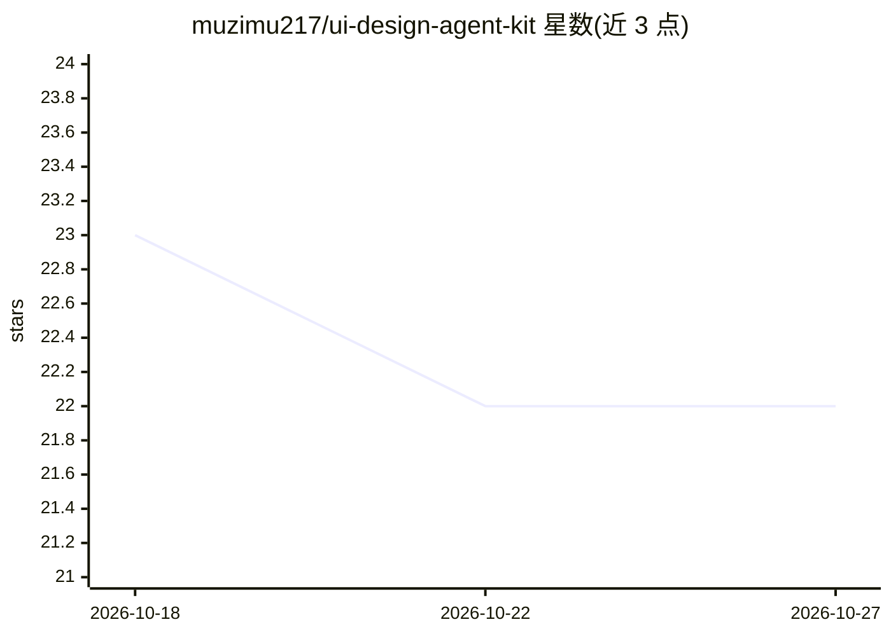

# muzimu217/ui-design-agent-kit

⭐ 22 · JavaScript · Apache-2.0 · 推送 2026-10-26 · [GitHub](https://github.com/muzimu217/ui-design-agent-kit) · [官网](https://agent.kcos.club) · 个人维护 · 中文 README

**面向 UI 设计的智能体提示词与工作流套件：从口语需求到可验收界面**

一套可安装到 13 个主流 AI 宿主（Codex、Claude Code、Cursor、Gemini CLI 等）的 UI 设计智能体指令层：23 个技能、六道门确认工作流、设计契约与五级证据等级。用户以口语描述需求，agent 先联网调研并呈交方向稿，经确认后实现界面并用浏览器采集验收证据。通过 npm 全局安装或 uak-init 命令接入现有项目；要求 Node ≥ 20.18.1，不提供模型服务，宿主需自备模型、MCP 配置与技能目录。

## 筛选速览

| 维度 | 判定 | 备注 |
|---|---|---|
| AI 角色 | `ai-ecosystem` | LLM/agent 周边工具 |
| 许可风险 | `permissive` | Apache-2.0 |
| 部署形态 | `library` | 以包/库形式分发 |
| 模型依赖 | — | README 未给出锁定关系 |
| 硬件要求 | — | 无带数字的原话,不猜 |
| 安装摩擦 | `low` | 无编译、无系统依赖或容器化 |
| 成熟度 | — | 结构信号不足 |

## 能力要点

- 23 个技能 + 六道门确认工作流，未过门不前进
- 一套提示词经一层转换接入 13 个 AI 宿主
- npm run prompt:build 可产出可迁移的单文件提示词
- 五级证据等级与浏览器实测验收纪律，附 12 个有证据的线上案例

## 适用场景

- 用日常语言描述 UI 需求，由 agent 产出需求摘要与开发提示词
- 为现有项目接入 UI 设计工作流并获得带浏览器证据的界面交付
- 在多个 AI 宿主间复用同一套 UI 设计提示词

## 场景标签

`提示工程` · 领域:Agent 开发

## 证据(README 行号)

> L42: > **这个仓库维护的是一个 UI 设计智能体工作流：通过 AI 调用技能、编排工具，帮人类设计更好的 UI——不是产品运行时，也不是研究项目本体。**
> L44: > - **是**：智能体指令层（23 技能 + 六道门确认工作流）、验证纪律（五级证据等级、131 项测试（2026-10-08 复核，以 npm test 实际输出为准）、浏览器实测）、可迁移提示词工厂、12 个有证据的线上案
> L52: 本工作流**不绑定单一宿主**：Codex、Claude Code、Cursor、Gemini CLI、GitHub Copilot、Windsurf、Cline、OpenCode、ZCode、DeepSeek Harness、O

## 星数曲线

2026-10-18 23 → 2026-10-27 22（-1）

---
*卡片 v1 · prompt 1.4 · 生成 2026-10-27 · 置信度 high · 依据 README sha `d642ddda545c` · [字段定义](../../DATASET.md)*
