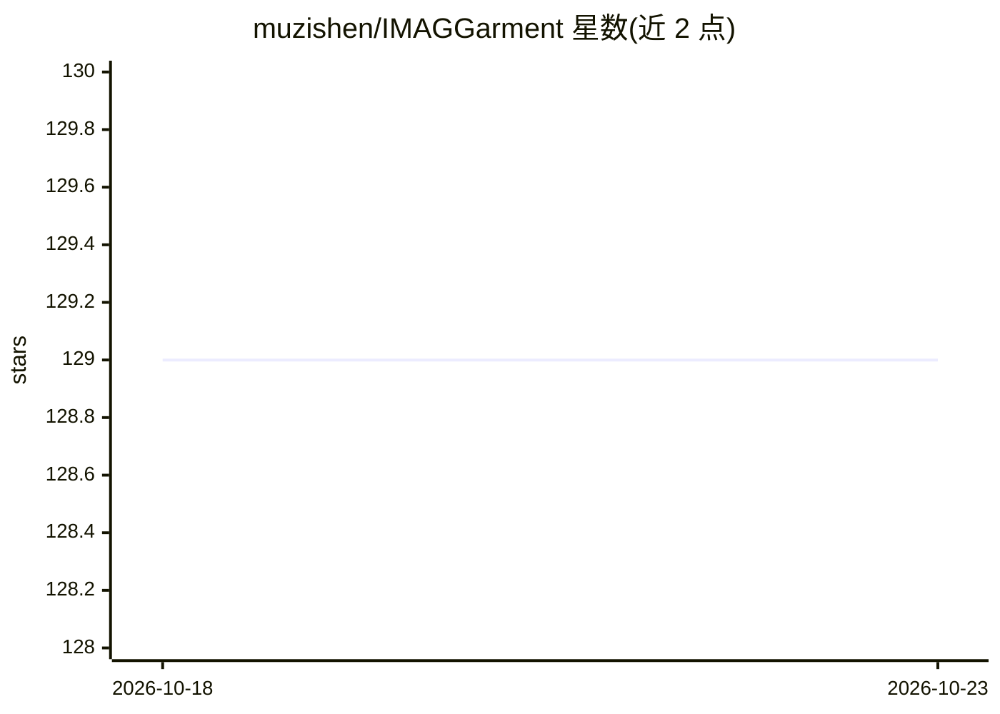

# muzishen/IMAGGarment

⭐ 129 · Python · Apache-2.0 · 推送 2026-03-13 · [GitHub](https://github.com/muzishen/IMAGGarment) · [官网](https://revive234.github.io/imaggarment.github.io/) · 组织维护 · 中文 README

**面向数字服装设计的细粒度可控服装图像生成模型（TVCG 2026）**

基于扩散模型的两阶段服装生成框架：第一阶段全局外观模型联合编码轮廓与颜色（混合注意力模块与颜色适配器），第二阶段局部增强模型注入用户自定义 logo 与空间约束，支持以草图、颜色、logo 等多条件引导的服装合成。提供训练与推理代码、模型权重（百度云下载），依赖 Stable Diffusion v1.5、IP-Adapter 等组件模型；配套数据集 GarmentBench 在 TODO 中尚未发布。作者来自南京理工大学团队，论文被 TVCG 2026 接收。

## 筛选速览

| 维度 | 判定 | 备注 |
|---|---|---|
| AI 角色 | `ai-native` | 本体是模型或模型工具 |
| 许可风险 | `permissive` | Apache-2.0 |
| 部署形态 | `library` | 以包/库形式分发 |
| 模型依赖 | — | README 未给出锁定关系 |
| 硬件要求 | — | 无带数字的原话,不猜 |
| 安装摩擦 | `medium` | 含编译或系统依赖之一 |
| 成熟度 | — | 结构信号不足 |

## 能力要点

- 两阶段训练：全局外观建模 + 局部细节（logo/空间约束）增强
- 多条件可控生成：草图、颜色、logo 引导
- 提供训练脚本与推理代码及模型权重

## 适用场景

- 数字服装设计中按草图与配色生成服装图
- 在服装图指定位置注入自定义 logo
- 服装生成相关的学术研究与复现

## 场景标签

`图像生成` · 领域:内容生成

## 证据(README 行号)

> L12: IMAGGarment addresses the challenges of multi-conditional controllability in personalized fashion design and digita
> L13: Specifically, IMAGGarment employs a two-stage training strategy to separately model global appearance and local det

## 星数曲线

2026-10-18 129 → 2026-10-23 129（+0）

---
*卡片 v1 · prompt 1.4 · 生成 2026-10-22 · 置信度 high · 依据 README sha `ae12b8ac0fa5` · [字段定义](../../DATASET.md)*
