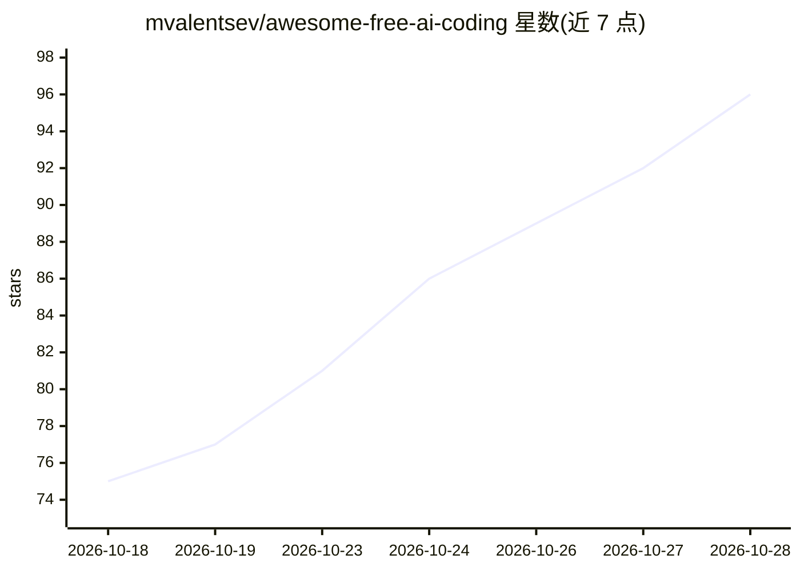

# mvalentsev/awesome-free-ai-coding

⭐ 99 · Python · MIT · 推送 2026-10-28 · [GitHub](https://github.com/mvalentsev/awesome-free-ai-coding) · [官网](https://mvalentsev.github.io/awesome-free-ai-coding/) · 个人维护

**合法免费 LLM API 与编程 agent 的验证式策展清单**

由自动化 pipeline 维护的 awesome 清单：收录 86 个免费 AI 编程相关服务的实时条目，覆盖编程 agent/CLI（opencode、Kilo Code、Google Antigravity 等）、带免费额度的 LLM API（Google AI Studio、Groq、NVIDIA NIM 等）与聚合网关。每条记录每周两次通过厂商 API 或定价页的实时探针核验，附核验日期与证据链接，过期条目移入 Archive；同时维护 131 个免费模型与 19 个高分模型在各服务上的可用性映射，并标注是否需要信用卡、数据是否可能用于训练。清单含配置片段帮助用户把 agent 接到免费通道。

## 筛选速览

| 维度 | 判定 | 备注 |
|---|---|---|
| AI 角色 | `ai-knowledge` | 知识聚合/清单类 |
| 许可风险 | `permissive` | MIT |
| 部署形态 | `None` |  |
| 模型依赖 | — | README 未给出锁定关系 |
| 硬件要求 | — | 无带数字的原话,不猜 |
| 安装摩擦 | `low` | 无编译、无系统依赖或容器化 |
| 成熟度 | — | 结构信号不足 |

## 能力要点

- 86 个免费服务条目，其中 82 个无需信用卡
- 每周两次自动化探针核验，每行附核验日期与证据
- 131 个免费模型与 19 个接近头部得分的模型按服务映射
- 提供 Claude Code / Codex 接入免费通道的配置说明

## 适用场景

- 找不绑卡就能用的免费 LLM API 或编程 agent
- 确认某个免费模型当前在哪些服务上可用
- 为 Claude Code / Codex CLI 配置免费模型通道

## 场景标签

`精选清单` · 领域:学习与行业

## 证据(README 行号)

> L1: awesome-free-ai-coding — 86 live offers, 82 need no card, 131 free models, 19 strong models; every offer probed twic
> L9: > Live probes check every row against the vendor's API or pricing page twice a week. Ended offers move to the Archiv
> L75:  **💳** — the row wants a card on file, 4 of 86, and no other row asks for one · **👁** — what you send may be used t

## 星数曲线

2026-10-18 75 → 2026-10-28 96（+21）

---
*卡片 v1 · prompt 1.4 · 生成 2026-10-24 · 置信度 high · 依据 README sha `a19f691ac626` · [字段定义](../../DATASET.md)*
