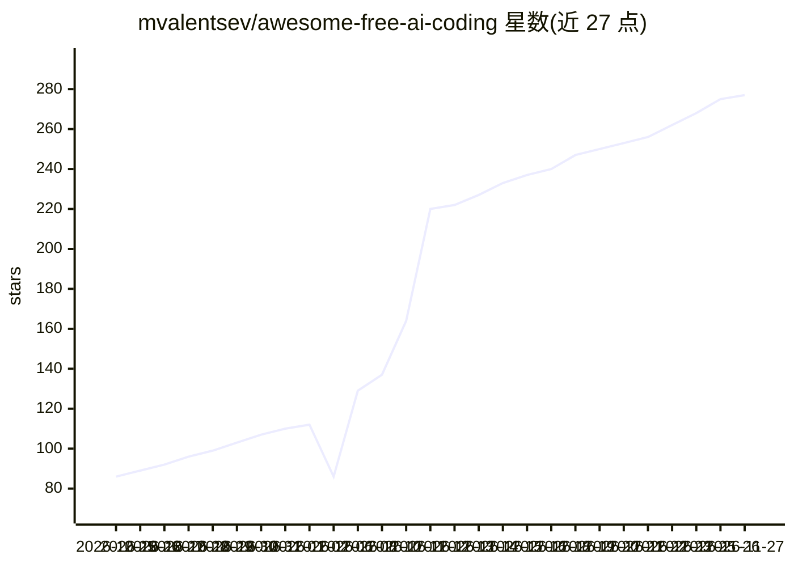

# mvalentsev/awesome-free-ai-coding

⭐ 277 · Python · MIT · 推送 2026-11-26 · [GitHub](https://github.com/mvalentsev/awesome-free-ai-coding) · [官网](https://mvalentsev.github.io/awesome-free-ai-coding/) · 个人维护

**免费 LLM API 与编码 agent 优惠的自动化核验清单**

以 awesome list 形式维护的免费 AI 编码资源目录：收录 117 条免费额度优惠（112 条无需信用卡）、145 个免费模型，其中 82 个 OpenAI 兼容。条目由自动化 pipeline 每周两次探测厂商 API 或定价页验证有效性，失效优惠移入 Archive 并保留证据链接；提供模型能力指数对比图、按需求分类的导航（免费 API、单 key 多模型、Claude Code/Codex CLI 免费通道）及可试用的 curl 示例。配套网站提供搜索与模型索引。

## 筛选速览

| 维度 | 判定 | 备注 |
|---|---|---|
| AI 角色 | `ai-knowledge` | 知识聚合/清单类 |
| 许可风险 | `permissive` | MIT |
| 部署形态 | `None` |  |
| 模型依赖 | — | README 未给出锁定关系 |
| 硬件要求 | — | 无带数字的原话,不猜 |
| 安装摩擦 | `low` | 无编译、无系统依赖或容器化 |
| 成熟度 | — | 结构信号不足 |

## 能力要点

- 117 条免费优惠每周两次自动探测核验，附证据链接
- 145 个免费模型中 82 个 OpenAI 兼容
- 按场景导航：免费 API、单 key 多模型、无账户试用、Claude Code/Codex CLI 免费通道
- 收录 27 个无需信用卡的编码 agent/CLI 免费套餐

## 适用场景

- 为零预算开发可用的编码 agent 找免费模型通道
- 对比各厂商免费额度是否需要绑卡及限制
- 为 Claude Code 或 Codex CLI 配置免费路由

## 场景标签

`精选清单` · 领域:学习与行业

## 证据(README 行号)

> L1: awesome-free-ai-coding — 117 live offers, 112 need no card, 145 free models, 82 OpenAI-compatible; every offer probe
> L9: > Live probes check every row against the vendor's API or pricing page twice a week. Ended offers move to the Archiv

## 星数曲线

2026-10-25 86 → 2026-11-27 277（+191）

---
*卡片 v1 · prompt 1.4 · 生成 2026-11-27 · 置信度 high · 依据 README sha `a71fde0c7e84` · [字段定义](../../DATASET.md)*
