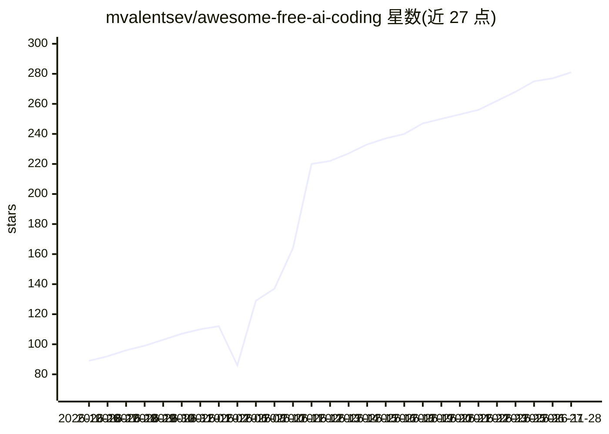

# mvalentsev/awesome-free-ai-coding

⭐ 281 · Python · MIT · 推送 2026-11-27 · [GitHub](https://github.com/mvalentsev/awesome-free-ai-coding) · [官网](https://mvalentsev.github.io/awesome-free-ai-coding/) · 个人维护

**免费 LLM API 与编程 Agent 清单，每周两次探测验证**

一份自动化维护的免费 AI 编码资源清单：收录 117 个免费优惠（112 个无需信用卡）、146 个免费模型，其中 82 个提供 OpenAI 兼容接口。内置探测流水线每周两次验证每一行条目是否仍然有效，失效条目移入 Archive，验证日期链接到证据页。内容按编程 Agent/CLI、免费 API、聚合器、试用等类别组织，附模型分数图表与连接编码 Agent 的 base URL/客户端配置。

## 筛选速览

| 维度 | 判定 | 备注 |
|---|---|---|
| AI 角色 | `ai-knowledge` | 知识聚合/清单类 |
| 许可风险 | `permissive` | MIT |
| 部署形态 | `None` |  |
| 模型依赖 | — | README 未给出锁定关系 |
| 硬件要求 | — | 无带数字的原话,不猜 |
| 安装摩擦 | `low` | 无编译、无系统依赖或容器化 |
| 成熟度 | — | 结构信号不足 |

## 能力要点

- 117 个免费优惠每周两次自动探测验证，验证日期链接证据
- 146 个免费模型索引，82 个 OpenAI 兼容
- 按需求分类导览：免费 API、一键多模型、免账号、无卡试用
- 提供 Claude Code shell functions 与 Codex CLI profiles 配置

## 适用场景

- 为编码 Agent 寻找可用的免费模型与 API 通道
- 对比哪些模型在哪些供应商可免费使用
- 挑选无需信用卡的试用方案

## 场景标签

`精选清单` · 领域:学习与行业

## 证据(README 行号)

> L1: awesome-free-ai-coding — 117 live offers, 112 need no card, 146 free models, 82 OpenAI-compatible; every offer probe
> L76: ## 📋 The list

## 星数曲线

2026-10-26 89 → 2026-11-28 281（+192）

---
*卡片 v1 · prompt 1.4 · 生成 2026-11-28 · 置信度 high · 依据 README sha `8d8e4c06bcff` · [字段定义](../../DATASET.md)*
