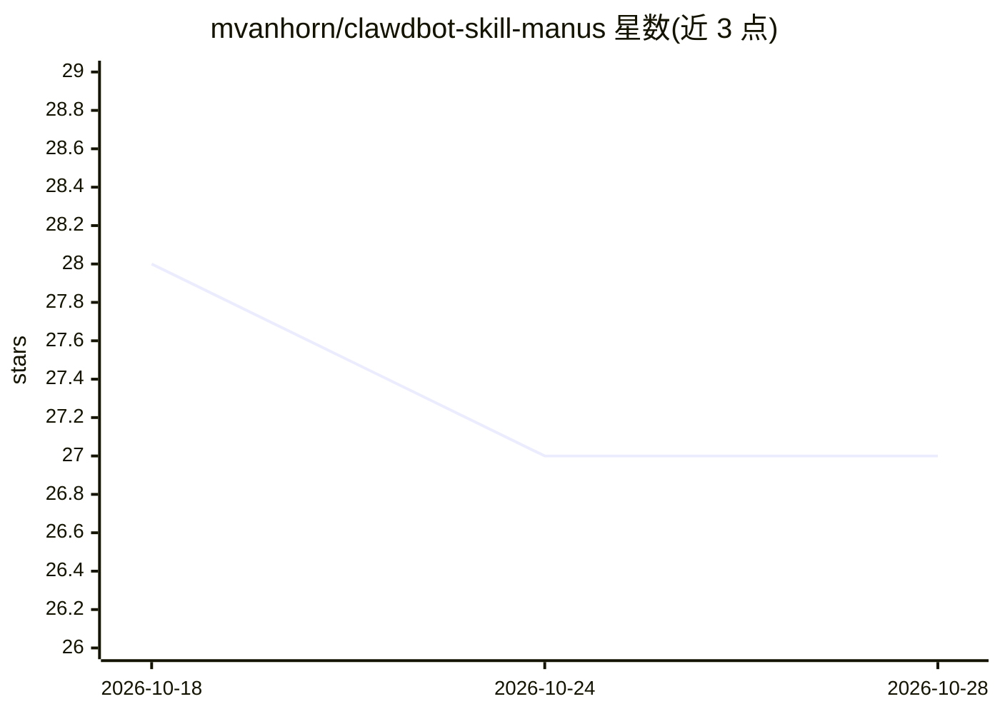

# mvanhorn/clawdbot-skill-manus

⭐ 27 · Shell · 推送 2026-03-16 · [GitHub](https://github.com/mvanhorn/clawdbot-skill-manus) · 个人维护

**OpenClaw 技能：将复杂任务委托给 Manus AI 自主代理**

面向 OpenClaw agent 框架的技能包：通过 Manus API 将网页调研、报告生成、代码构建、数据抓取等复杂任务委托给 Manus 自主代理执行。提供任务模板、任务 CRUD、文件上传（预签名 S3 URL）、项目级持久指令、多轮对话、Webhook 事件与任务状态轮询，任务完成后下载 PDF/幻灯片/代码/CSV 等交付物。含 CLI 脚本辅助操作。需自行申请 Manus API key（环境变量配置），按 agent 档位（standard/lite/max）计费。

## 筛选速览

| 维度 | 判定 | 备注 |
|---|---|---|
| AI 角色 | `ai-ecosystem` | LLM/agent 周边工具 |
| 许可风险 | `none` | — |
| 部署形态 | `None` |  |
| 模型依赖 | — | README 未给出锁定关系 |
| 硬件要求 | — | 无带数字的原话,不猜 |
| 安装摩擦 | `low` | 无编译、无系统依赖或容器化 |
| 成熟度 | — | 结构信号不足 |

## 能力要点

- 任务模板覆盖调研、报告生成、代码构建、数据抓取
- 完整任务 CRUD、多轮对话与 Webhook 事件（task_created/progress/stopped）
- Files API 预签名 S3 URL 上传文件并附加到任务
- 三个 agent 档位（manus-1.6/lite/max）按任务复杂度选择

## 适用场景

- 让 agent 委托 Manus 完成深度调研并产出报告
- 抓取网页数据并输出 CSV 交付物
- 在项目中持续委托并迭代多轮任务

## 场景标签

`Agent 框架` `网页抓取` `科研工具` · 领域:Agent 开发

## 证据(README 行号)

> L1: # Manus Skill for OpenClaw
> L3: Delegate complex tasks to Manus, an autonomous AI agent that can browse the web, use tools, and deliver complete wor
> L24: git clone https://github.com/mvanhorn/clawdbot-skill-manus.git ~/.openclaw/skills/manus

## 星数曲线

2026-10-18 28 → 2026-10-28 27（-1）

---
*卡片 v1 · prompt 1.4 · 生成 2026-10-26 · 置信度 high · 依据 README sha `2ff103626562` · [字段定义](../../DATASET.md)*
