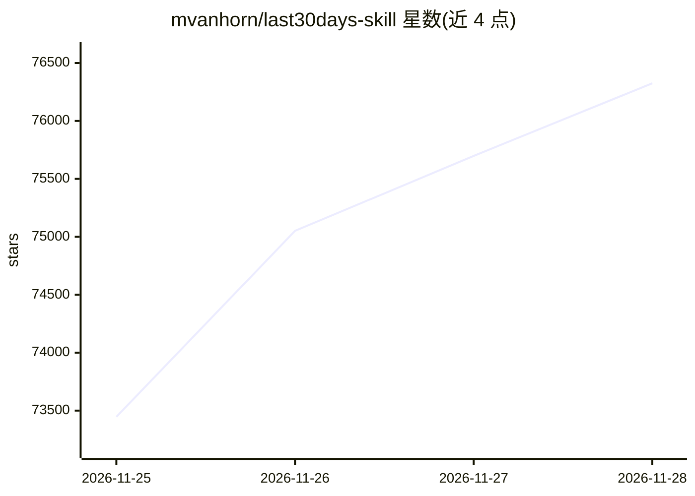

# mvanhorn/last30days-skill

⭐ 76,325 · Python · MIT · 推送 2026-11-27 · [GitHub](https://github.com/mvanhorn/last30days-skill) · 个人维护 · 中文 README

**让 AI agent 汇总近30天多平台舆情并生成简要报告的技能**

一个安装到 Claude Code、Codex、Cursor 等 50+ Agent Skills 宿主的技能，接收人物、公司或话题作为查询，并行检索 Reddit、X、YouTube、HN、Polymarket 等 20 余个来源，按点赞、upvote、市场赔率等真实用户互动信号打分，再由 agent 合成一份带引用的简报。零配置即可用 Reddit、HN、Polymarket、GitHub、专利与招聘页面；X、YouTube、TikTok 等来源需通过首次运行向导配置凭据或本地工具。提供 Claude Code 插件市场与 npx 两种安装路径。

## 筛选速览

| 维度 | 判定 | 备注 |
|---|---|---|
| AI 角色 | `ai-native` | 本体是模型或模型工具 |
| 许可风险 | `permissive` | MIT |
| 部署形态 | `library` | 以包/库形式分发 |
| 模型依赖 | — | README 未给出锁定关系 |
| 硬件要求 | — | 无带数字的原话,不猜 |
| 安装摩擦 | `low` | 无编译、无系统依赖或容器化 |
| 成熟度 | — | 结构信号不足 |

## 能力要点

- 并行检索 Reddit、X、YouTube、HN、Polymarket 等 20+ 来源
- 按 upvote/点赞/真金赔率等社区互动信号排序合成
- 支持人物、公司、话题及趋势发现（discovery）模式
- 零配置即用部分来源，其余经设置向导在 30 秒内解锁

## 适用场景

- 会面前快速了解某人近30天的动态与社区评价
- 调研一家公司未发布的产品线索（招聘页、专利、股价）
- 发现正在升温的 AI/科技话题
- 对比多个工具近期的社区口碑

## 场景标签

`网页抓取` · 领域:效率与自动化

## 证据(README 行号)

> L19: **An AI agent-led search engine scored by upvotes, likes, and real money - not editors.**
> L29: **Codex, Cursor, Copilot, Gemini CLI, or any of 50+ Agent Skills hosts:**
> L39: Reddit upvotes. X likes. YouTube transcripts. TikTok engagement. Polymarket odds backed by real money and insider i

## 星数曲线

2026-11-25 73,446 → 2026-11-28 76,325（+2,879）

---
*卡片 v1 · prompt 1.4 · 生成 2026-11-27 · 置信度 high · 依据 README sha `2fe0a3eea4cd` · [字段定义](../../DATASET.md)*
