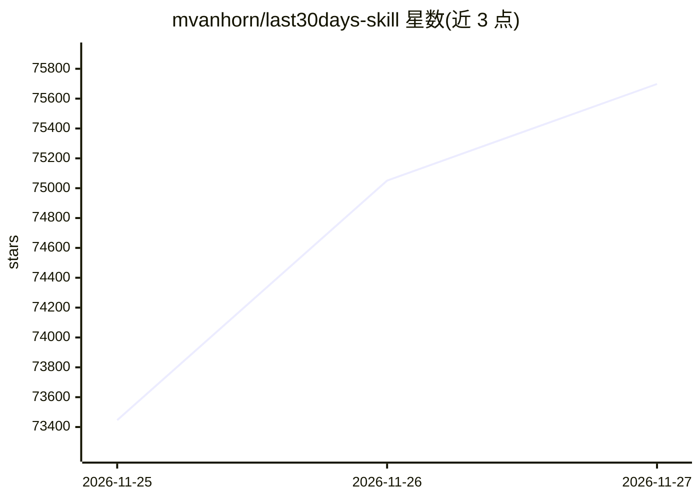

# mvanhorn/last30days-skill

⭐ 75,698 · Python · MIT · 推送 2026-11-26 · [GitHub](https://github.com/mvanhorn/last30days-skill) · 个人维护

**AI agent 技能：跨多平台检索近 30 天舆情并合成简报**

以 /last30days 命令形式安装到 Claude Code、Codex、Cursor 等运行环境的 agent 技能，并行检索 Reddit、X、YouTube、TikTok、HN、Polymarket、GitHub 等约 30 个信息源，按点赞、 upvote、市场赔率等用户行为信号排序，再由 AI agent 合成一份主题简报。Reddit、HN、Polymarket、GitHub、专利与招聘页零配置即用；X、YouTube、arXiv 等源通过首运行的设置向导（30 秒）解锁，部分源需自带 API key 或本地 CLI 工具在 PATH 上。

## 筛选速览

| 维度 | 判定 | 备注 |
|---|---|---|
| AI 角色 | `ai-native` | 本体是模型或模型工具 |
| 许可风险 | `permissive` | MIT |
| 部署形态 | `library` | 以包/库形式分发 |
| 模型依赖 | — | README 未给出锁定关系 |
| 硬件要求 | — | 无带数字的原话,不猜 |
| 安装摩擦 | `low` | 无编译、无系统依赖或容器化 |
| 成熟度 | — | 结构信号不足 |

## 能力要点

- 并行检索约 30 个平台并按真实用户互动信号打分排序
- 零配置可用 Reddit/HN/Polymarket/GitHub，设置向导解锁其余源
- 发现模式：扫描多源后输出 5-10 个按动量排序的新兴话题
- 提供 Claude Code 插件市场与 npx skills 两种安装方式

## 适用场景

- 见面前检索某个人近 30 天的动态与社区讨论
- 公司尽调：查招聘信号、专利、股价与市场赔率
- 发现正在升温的 AI 话题，找选题
- 对比多个工具的实时社区反馈

## 场景标签

`科研工具` · 领域:学习与行业

## 证据(README 行号)

> L19: **An AI agent-led search engine scored by upvotes, likes, and real money - not editors.**
> L39: Reddit upvotes. X likes. YouTube transcripts. TikTok engagement. Polymarket odds backed by real money and insider i
> L65: |**Reddit**|The unfiltered take. Top comments with real upvote counts, free, no API key. The real opinions that Goo

## 星数曲线

2026-11-25 73,446 → 2026-11-27 75,698（+2,252）

---
*卡片 v1 · prompt 1.4 · 生成 2026-11-26 · 置信度 high · 依据 README sha `3d53852bd93b` · [字段定义](../../DATASET.md)*
