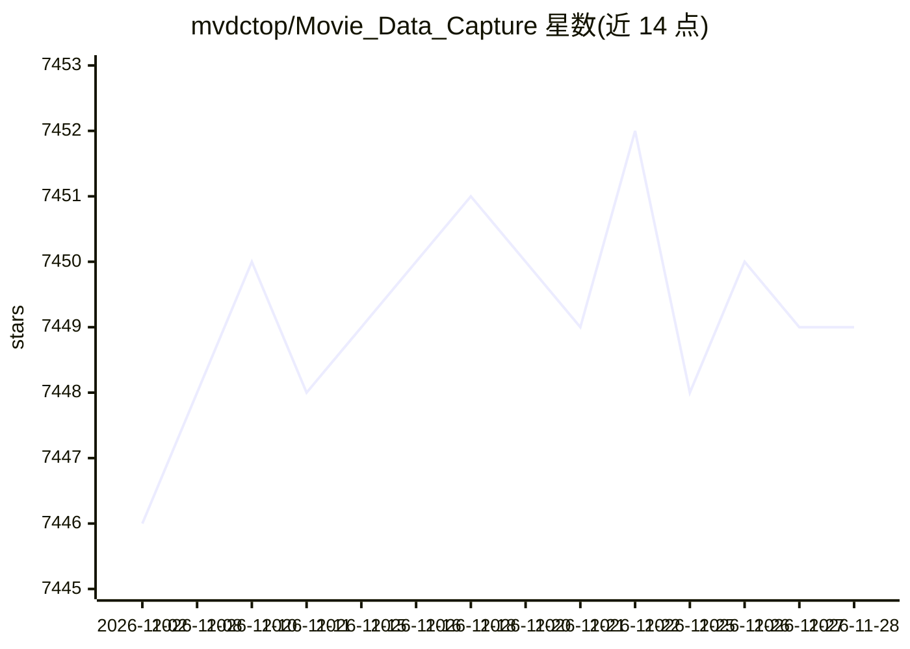

# mvdctop/Movie_Data_Capture

⭐ 7,449 · Python · GPL-3.0 · 推送 2026-11-26 · [GitHub](https://github.com/mvdctop/Movie_Data_Capture) · [官网](https://www.mvdc.top) · 组织维护 · 中文 README

**本地媒体库刮削工具：用 AI 解析网页补全元数据**

用于整理电影和电视剧媒体文件的工具：自动识别媒体文件并刮削标题、演员、简介、海报、背景图等信息，生成标准 NFO 文件与图片资产。当常规刮削无法获取信息时，可调用 AI 从具体网页提取元数据，解析结果可在保存前检查和修改。支持单文件与批量刮削、自定义命名和目录整理、本地与云端配置、Docker 部署，输出的 NFO 兼容 Emby、Jellyfin、Plex 等媒体服务器。

## 筛选速览

| 维度 | 判定 | 备注 |
|---|---|---|
| AI 角色 | `ai-enhanced` | 去掉 AI 部分产品仍成立 |
| 许可风险 | `viral` | GPL-3.0 |
| 部署形态 | `None` |  |
| 模型依赖 | — | README 未给出锁定关系 |
| 硬件要求 | — | 无带数字的原话,不猜 |
| 安装摩擦 | `low` | 无编译、无系统依赖或容器化 |
| 成熟度 | — | 结构信号不足 |

## 能力要点

- 自动刮削媒体信息并生成标准 NFO、海报和背景图
- AI 全能解析：常规刮削失败时从网页提取元数据
- 兼容 Emby、Jellyfin、Plex 等媒体服务器
- 支持 Docker 部署与本地/云端配置

## 适用场景

- 整理个人电影和电视剧收藏
- 配合 NAS 创建家庭媒体库
- 批量规范媒体文件名和目录结构

## 场景标签

`网页抓取` · 领域:效率与自动化

## 证据(README 行号)

> L13: - **支持 AI 解析几乎所有网页媒体信息**
> L25: 当常规刮削无法获取媒体信息时，可以使用 AI 从具体网页中提取：

## 星数曲线

2026-11-02 7,446 → 2026-11-28 7,449（+3）

---
*卡片 v1 · prompt 1.4 · 生成 2026-11-27 · 置信度 mid · 依据 README sha `39d2eecd14dd` · [字段定义](../../DATASET.md)*
