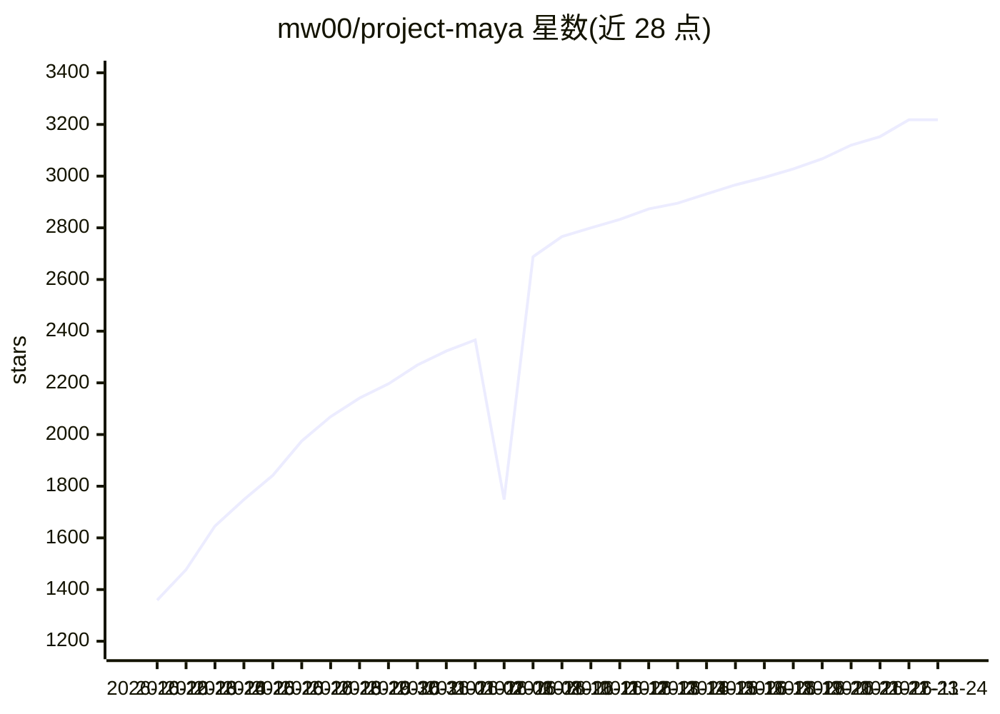

# mw00/project-maya

⭐ 3,218 · Cuda · MIT · 推送 2026-11-22 · [GitHub](https://github.com/mw00/project-maya) · [官网](https://huggingface.co/peasantsmith) · 个人维护

**在自己 GPU 上本地运行多个大型 MoE 模型的推理引擎与 API 服务**

Project Maya 为 GLM-5.3、GLM-5.3-Flash、DeepSeek-V4.1-Flash、MiniMax-M3.1-Flash、Hy4-Flash 等混合专家模型提供每模型专属的推理引擎，把专家权重按使用频率分层放置在 GPU、RAM 与 NVMe SSD 之间并在对话中调度，自动测量硬件并自行调参。提供 OpenAI 与 Anthropic 兼容 API、工具调用、最多 8 路并发、浏览器内聊天界面与模型管理页。通过 git clone 加 setup.sh 一键安装，支持 NVIDIA（V100/RTX 20 起）、AMD 与 Windows，最低 8 GB 显存起步。

## 筛选速览

| 维度 | 判定 | 备注 |
|---|---|---|
| AI 角色 | `ai-ecosystem` | LLM/agent 周边工具 |
| 许可风险 | `permissive` | MIT |
| 部署形态 | `None` |  |
| 模型依赖 | — | README 未给出锁定关系 |
| 硬件要求 | — | 无带数字的原话,不猜 |
| 安装摩擦 | `medium` | 含编译或系统依赖之一 |
| 成熟度 | — | 结构信号不足 |

## 能力要点

- 专家权重在 GPU/RAM/SSD 间分层存放并随对话移动
- OpenAI- 与 Anthropic-兼容 API，支持工具调用
- 并发响应最多 8 路请求
- 提供各量化档相对原模型 next-token 一致率与零样本准确率数据

## 适用场景

- 在自己的 PC 或多卡工作站上运行 744B/748B 级别模型
- 为编码 agent 提供本地兼容 API 后端
- 多人共用一台机器并发调用本地模型

## 场景标签

`推理引擎` · 领域:训练与推理

## 证据(README 行号)

> L26: **GLM-5.3**, **GLM-5.3-Flash**, **DeepSeek-V4.1-Flash-1017**, **MiniMax-M3.1-Flash** and **Hy4-Flash**. Each model 
> L35: - **Plugs into your tools:** OpenAI- and Anthropic-compatible API with tool calls, ready for coding agents.
> L44: git clone https://github.com/mw00/project-maya.git && cd project-maya

## 星数曲线

2026-10-22 1,359 → 2026-11-24 3,218（+1,859）

---
*卡片 v1 · prompt 1.4 · 生成 2026-11-23 · 置信度 high · 依据 README sha `f9104e09cd94` · [字段定义](../../DATASET.md)*
