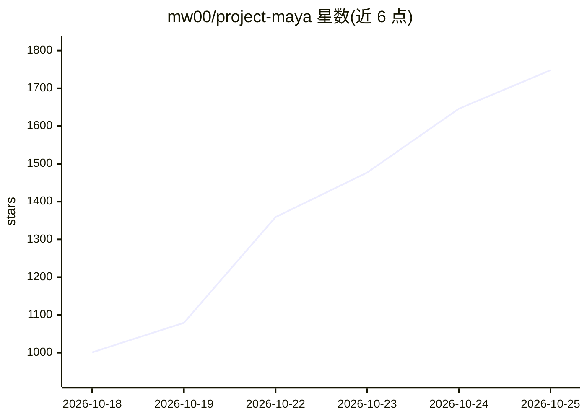

# mw00/project-maya

⭐ 1,748 · C++ · MIT · 推送 2026-10-23 · [GitHub](https://github.com/mw00/project-maya) · [官网](https://huggingface.co/peasantsmith) · 个人维护

**在自有 GPU 上私有运行 GLM-5.3-Flash/DeepSeek-V4.1-Flash 的推理套件**

面向想在本地硬件上运行超大规模 MoE 模型的用户：为 GLM-5.3-Flash（321B）和 DeepSeek-V4.1-Flash-1017（748B）提供专用引擎，支持 1-16 张 NVIDIA GPU 或部分 AMD 卡，通过自研量化把常驻专家放在 VRAM/RAM/NVMe 分层管理，并按机器测量自动调参。提供浏览器聊天界面、实时监控、图像输入与 OpenAI/Anthropic 兼容 API（含工具调用），最多 8 个并发请求。一条 git clone + setup.sh 命令安装，首次构建 20-40 分钟。AMD 与 Windows 支持为实验性。

## 筛选速览

| 维度 | 判定 | 备注 |
|---|---|---|
| AI 角色 | `ai-ecosystem` | LLM/agent 周边工具 |
| 许可风险 | `permissive` | MIT |
| 部署形态 | `library` | 以包/库形式分发 |
| 模型依赖 | — | README 未给出锁定关系 |
| 硬件要求 | — | 无带数字的原话,不猜 |
| 安装摩擦 | `medium` | 含编译或系统依赖之一 |
| 成熟度 | `idea` | |

## 能力要点

- 自研多档量化（Maya-S/S24/M/L），保留 MTP 块并给出与 FP8 原版的准确率对照
- 专家分层放置（GPU→RAM→NVMe SSD）并按硬件自动调参
- OpenAI/Anthropic 兼容 API，支持工具调用，最多 8 路并发
- 浏览器内聊天、实时监控与图像输入，一命令安装

## 适用场景

- 在 1-16 张消费级/专业卡上私有部署超大 MoE 模型
- 通过 OpenAI/Anthropic 兼容 API 接入自己的编码 agent 与工具
- 在单机多人或单人多会话场景下并行跑多个请求

## 场景标签

`推理引擎` `模型量化` · 领域:训练与推理

## 证据(README 行号)

> L3:  GLM-5.3-Flash (321 B) and DeepSeek-V4.1-Flash-1017 (748 B) on your own GPU
> L24: - **Plugs into your tools:** OpenAI- and Anthropic-compatible API with tool calls, ready for coding agents.
> L139: git clone https://github.com/mw00/project-maya.git && cd project-maya

## 星数曲线

2026-10-18 1,001 → 2026-10-25 1,748（+747）

---
*卡片 v1 · prompt 1.4 · 生成 2026-10-21 · 置信度 mid · 依据 README sha `0234c664a4b9` · [字段定义](../../DATASET.md)*
