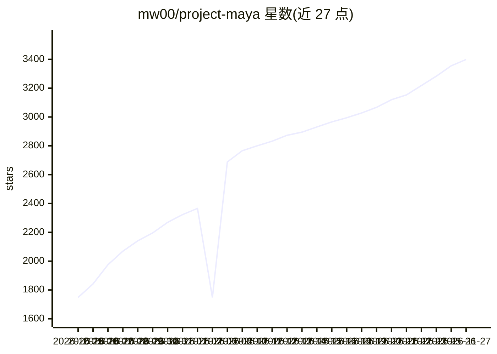

# mw00/project-maya

⭐ 3,399 · Cuda · MIT · 推送 2026-11-26 · [GitHub](https://github.com/mw00/project-maya) · [官网](https://huggingface.co/peasantsmith) · 个人维护

**在自有 GPU 上本地运行多个超大 MoE 模型的推理引擎与仪表盘**

为 GLM-5.3、DeepSeek-V4.1-Flash、MiniMax-M3.1-Flash、Hy4-Flash、Inkling 2 Mini 等大参数 MoE 模型提供各自的本地推理引擎：按对话热度的三级放置策略把专家分布在 GPU/RAM/NVMe 之间并随对话迁移，启动时测量硬件并自调参数。提供浏览器内聊天、实时监控、模型下载/加载/删除页面，以及 OpenAI 与 Anthropic 兼容 API，支持并发最多 8 路请求。NVIDIA（V100/RTX 20 起）、AMD、Windows 均可运行，Setup 脚本按机器内存池推荐量化档位（XS/S/M/L）。

## 筛选速览

| 维度 | 判定 | 备注 |
|---|---|---|
| AI 角色 | `ai-ecosystem` | LLM/agent 周边工具 |
| 许可风险 | `permissive` | MIT |
| 部署形态 | `None` |  |
| 模型依赖 | — | README 未给出锁定关系 |
| 硬件要求 | `gpu-24g` | |
| 安装摩擦 | `medium` | 含编译或系统依赖之一 |
| 成熟度 | — | 结构信号不足 |

## 能力要点

- 专家分层放置（GPU/RAM/NVMe）并随对话动态迁移，启动时自动测量硬件调参
- OpenAI- 与 Anthropic- 兼容 API，含工具调用，最多 8 路并发请求
- 每个模型有专属引擎与自产量化档位（XS/S/M/L），附带对原始 FP8 的一致率数据
- 内置浏览器聊天界面、实时监控与 ./maya.sh --bench 基准测试命令

## 适用场景

- 在自己的 GPU 上私有运行数百 B 级 MoE 大模型
- 给本地编码 agent 提供 OpenAI/Anthropic 兼容 API 端点
- 一台工作站上多人或多个 agent 会话共用同一模型
- 用 --bench 收集并分享不同硬件配置的推理速度数据

## 场景标签

`推理引擎` `模型量化` · 领域:训练与推理

## 证据(README 行号)

> L27: **GLM-5.3**, **GLM-5.3-Flash**, **DeepSeek-V4.1-Flash-1017**, **MiniMax-M3.1-Flash** and **Hy4-Flash** - and the sm
> L28: keeps the experts your conversation uses most on the GPU, the next ones in RAM and the rest on your NVMe SSD, and m
> L36: - **Plugs into your tools:** OpenAI- and Anthropic-compatible API with tool calls, ready for coding agents.

## 星数曲线

2026-10-25 1,748 → 2026-11-27 3,399（+1,651）

---
*卡片 v1 · prompt 1.4 · 生成 2026-11-27 · 置信度 high · 依据 README sha `4d251248b199` · [字段定义](../../DATASET.md)*
