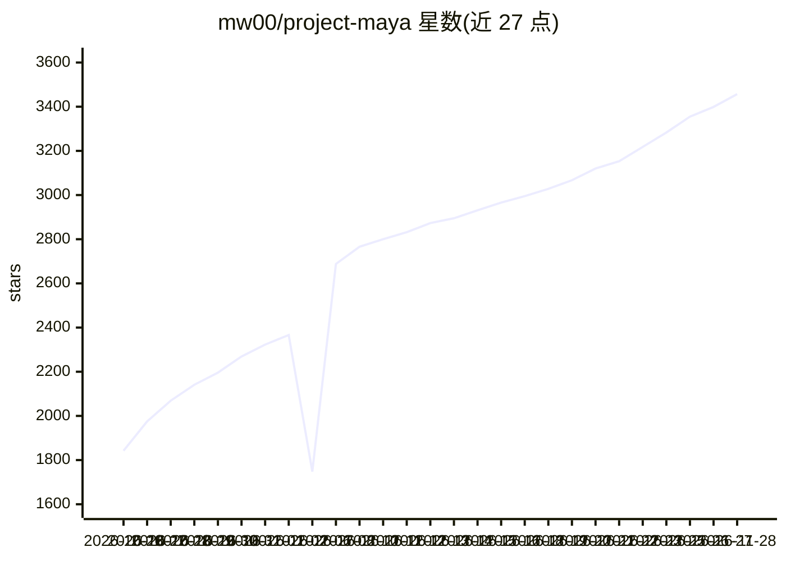

# mw00/project-maya

⭐ 3,457 · Cuda · MIT · 推送 2026-11-27 · [GitHub](https://github.com/mw00/project-maya) · [官网](https://huggingface.co/peasantsmith) · 个人维护 · 中文 README

**在自有 GPU 上本地运行超大 MoE 模型的推理运行时与仪表盘**

为 GLM-5.3、DeepSeek-V4.1-Flash、MiniMax-M3.1-Flash 等多款百亿至千亿级 MoE 模型提供本地推理引擎：按对话使用情况将专家权重在 GPU、RAM 与 NVMe SSD 之间调度，并自动测量硬件自我调参。提供浏览器聊天界面、模型下载/加载/删除管理页、并发请求（最多 8 路）与 OpenAI/Anthropic 兼容 API。通过 setup.sh 一键安装，支持 NVIDIA（V100/RTX 20 起）与 AMD、Linux 与 Windows，附带用户实测的性能基准表。

## 筛选速览

| 维度 | 判定 | 备注 |
|---|---|---|
| AI 角色 | `ai-ecosystem` | LLM/agent 周边工具 |
| 许可风险 | `permissive` | MIT |
| 部署形态 | `None` |  |
| 模型依赖 | — | README 未给出锁定关系 |
| 硬件要求 | `gpu-24g` | |
| 安装摩擦 | `medium` | 含编译或系统依赖之一 |
| 成熟度 | — | 结构信号不足 |

## 能力要点

- 专家权重在 GPU/RAM/SSD 间自动分层调度与自调参
- OpenAI- 与 Anthropic 兼容 API，支持 tool calls
- 浏览器内置聊天界面、实时监控与模型管理页
- 面向不同内存池的多档量化（XS/S/M/L）可选

## 适用场景

- 在单张或多张消费级 GPU 上本地运行 700B 级开源模型
- 为本地编码 agent 提供 OpenAI/Anthropic 兼容接口
- 一台 PC 上多人或多会话并发使用本地模型

## 场景标签

`推理引擎` · 领域:训练与推理

## 证据(README 行号)

> L28: **GLM-5.3**, **GLM-5.3-Flash**, **DeepSeek-V4.1-Flash-1017**, **MiniMax-M3.1-Flash**, **Hy4-Flash** and **Ling-3.2-
> L37: - **Plugs into your tools:** OpenAI- and Anthropic-compatible API with tool calls, ready for coding agents.
> L46: git clone https://github.com/mw00/project-maya.git && cd project-maya

## 星数曲线

2026-10-26 1,842 → 2026-11-28 3,457（+1,615）

---
*卡片 v1 · prompt 1.4 · 生成 2026-11-28 · 置信度 high · 依据 README sha `f6324938a245` · [字段定义](../../DATASET.md)*
