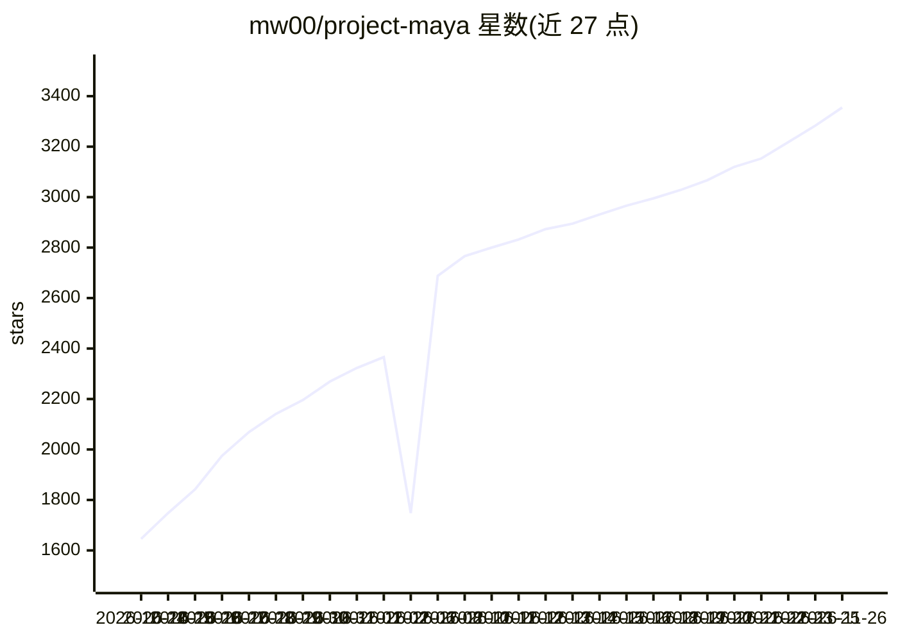

# mw00/project-maya

⭐ 3,355 · Cuda · MIT · 推送 2026-11-25 · [GitHub](https://github.com/mw00/project-maya) · [官网](https://huggingface.co/peasantsmith) · 个人维护

**让个人 GPU 本地运行多个超大 MoE 模型的推理运行时**

Project Maya 为 GLM-5.3、DeepSeek-V4.1-Flash、MiniMax-M3.1-Flash、Hy4-Flash、Inkling 2 Mini 等大参数 MoE 模型提供本地推理引擎与量化权重（XS/S/M/L 分层）。核心机制是把常用专家置于 GPU、其余放进内存与 NVMe SSD 并随对话移动，并按机器的 GPU/CPU/RAM/SSD 自动调参。提供浏览器内聊天、模型下载/加载/删除页面、实时监控，以及 OpenAI 与 Anthropic 兼容 API，支持多请求并发。数据不离开本机。面向想在自有硬件上运行这些模型的人。

## 筛选速览

| 维度 | 判定 | 备注 |
|---|---|---|
| AI 角色 | `ai-ecosystem` | LLM/agent 周边工具 |
| 许可风险 | `permissive` | MIT |
| 部署形态 | `None` |  |
| 模型依赖 | — | README 未给出锁定关系 |
| 硬件要求 | `gpu-24g` | |
| 安装摩擦 | `medium` | 含编译或系统依赖之一 |
| 成熟度 | — | 结构信号不足 |

## 能力要点

- 专家分层存放于 GPU/RAM/SSD 并按对话动态移动
- OpenAI- 与 Anthropic- 兼容 API，支持工具调用与最多 8 路并发
- 按 GPU、CPU、RAM、SSD 自测量自调参；setup.sh 一条命令安装启动
- 每种模型有专门构建的引擎与多档量化（XS/S/M/L）

## 适用场景

- 在单张或少数几张消费级 GPU 上本地运行数百 B 参数的 MoE 模型
- 给编码 agent 提供 OpenAI/Anthropic 兼容的本地 API 后端
- 一台机器上多人或多个会话并发使用本地模型
- 在无网络外传的前提下私有部署聊天与图片理解

## 场景标签

`推理引擎` · 领域:训练与推理

## 证据(README 行号)

> L26: Models this size usually need a datacenter. Maya runs five of them on the hardware you already have:
> L29: them as you chat. It measures your GPUs, CPU, RAM and SSD and tunes itself to them. Nothing leaves your machine.
> L36: - **Plugs into your tools:** OpenAI- and Anthropic-compatible API with tool calls, ready for coding agents.

## 星数曲线

2026-10-24 1,646 → 2026-11-26 3,355（+1,709）

---
*卡片 v1 · prompt 1.4 · 生成 2026-11-26 · 置信度 high · 依据 README sha `a746a4a73588` · [字段定义](../../DATASET.md)*
