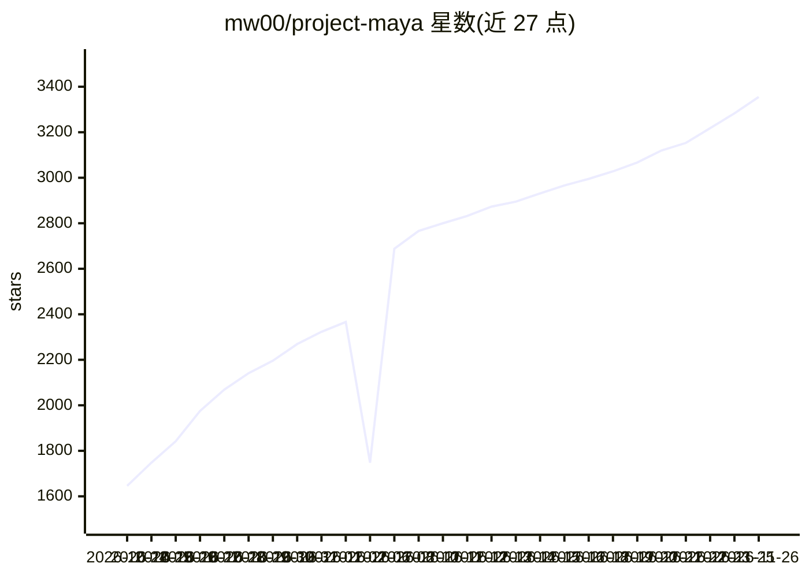

# mw00/project-maya

⭐ 3,355 · Cuda · MIT · 推送 2026-11-25 · [GitHub](https://github.com/mw00/project-maya) · [官网](https://huggingface.co/peasantsmith) · 个人维护

**在自己的 GPU 上运行五个大模型的本地推理引擎与仪表盘**

为 GLM-5.3、GLM-5.3-Flash、DeepSeek-V4.1-Flash、MiniMax-M3.1-Flash 和 Hy4-Flash 各自提供专用推理引擎，按对话使用情况在 GPU、RAM 与 NVMe SSD 之间调度专家权重，并依据本机硬件自调参数。提供浏览器聊天界面、实时监控、模型下载/加载/删除页面，以及兼容 OpenAI 与 Anthropic 的 API（支持工具调用、最多 8 路并发）。从 8 GB 显存起步，支持 NVIDIA 与 AMD、Linux 与 Windows，通过 setup.sh 一键安装启动。

## 筛选速览

| 维度 | 判定 | 备注 |
|---|---|---|
| AI 角色 | `ai-ecosystem` | LLM/agent 周边工具 |
| 许可风险 | `permissive` | MIT |
| 部署形态 | `None` |  |
| 模型依赖 | — | README 未给出锁定关系 |
| 硬件要求 | — | 无带数字的原话,不猜 |
| 安装摩擦 | `medium` | 含编译或系统依赖之一 |
| 成熟度 | — | 结构信号不足 |

## 能力要点

- 每个模型配专用引擎，专家权重在 GPU/RAM/SSD 间自动迁移
- OpenAI- 与 Anthropic- 兼容 API，支持工具调用
- 最多 8 个请求并发（GLM-5.3-Flash、DeepSeek、MiniMax-Flash）
- 自带浏览器聊天界面、实时监控与一键 setup 脚本

## 适用场景

- 在没有数据中心硬件的本地 PC 上运行百亿至千亿参数模型
- 给 coding agent 提供本地 OpenAI/Anthropic 兼容 API
- 一台机器上多人或多个 agent 会话共用同一组 GPU

## 场景标签

`推理引擎` · 领域:训练与推理

## 证据(README 行号)

> L25: Models this size usually need a datacenter. Maya runs five of them on the hardware you already have:
> L27: keeps the experts your conversation uses most on the GPU, the next ones in RAM and the rest on your NVMe SSD, and m
> L35: - **Plugs into your tools:** OpenAI- and Anthropic-compatible API with tool calls, ready for coding agents.

## 星数曲线

2026-10-24 1,646 → 2026-11-26 3,355（+1,709）

---
*卡片 v1 · prompt 1.4 · 生成 2026-11-24 · 置信度 high · 依据 README sha `c80b2fd71d5b` · [字段定义](../../DATASET.md)*
