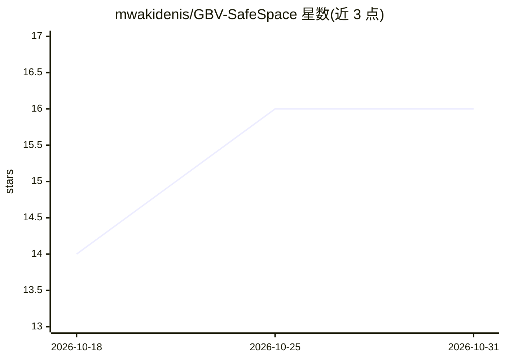

# mwakidenis/GBV-SafeSpace

⭐ 16 · TypeScript · 推送 2026-10-28 · [GitHub](https://github.com/mwakidenis/GBV-SafeSpace) · [官网](https://hera-safehaven.vercel.app/) · 个人维护

**面向非洲女性与女孩的性别暴力防护数字平台**

面向肯尼亚等非洲地区女性与女孩的数字安全 Web 应用，功能围绕性别暴力（GBV）防护组织：AI 毒性检测与安全改写、幸存者支持门户（英/斯瓦希里/法/阿四语、RTL 支持、本地紧急资源）、AI 支持助手（语音输入、流式回复、危机识别）、9 课数字素养课程、AES 加密证据柜、匿名社区论坛与端到端加密私信、SOS 伪装计算器快速退出、管理面板。技术栈为 React/TypeScript/Supabase。限制：README 未列出 AI 模型提供方细节与部署地址。

## 筛选速览

| 维度 | 判定 | 备注 |
|---|---|---|
| AI 角色 | `ai-native` | 本体是模型或模型工具 |
| 许可风险 | `none` | — |
| 部署形态 | `library` | 以包/库形式分发 |
| 模型依赖 | — | README 未给出锁定关系 |
| 硬件要求 | — | 无带数字的原话,不猜 |
| 安装摩擦 | `low` | 无编译、无系统依赖或容器化 |
| 成熟度 | — | 结构信号不足 |

## 能力要点

- AI 数字暴力检测：实时毒性分析、内容分类与安全改写
- 多语言幸存者支持门户（英/斯瓦希里/法/阿语，含 RTL）
- 四语语音输入的 AI 支持助手，具备危机识别与转介
- 证据柜 AES 加密与 SOS 伪装计算器退出

## 适用场景

- 遭遇网络骚扰时检测并改写有害内容
- 以匿名方式记录证据、发帖求助或私信交流
- 通过互动课程学习数字安全知识
- 危险情境下一键切换到伪装计算器界面

## 场景标签

 · 领域:社会公益/数字安全

## 证据(README 行号)

> L5: **Empowering women and girls across Africa with AI-powered protection, survivor support, and digital literacy educat
> L71: **Current Features:**
> L98: - **AI-Powered Support**: Compassionate AI companion for survivors

## 星数曲线

2026-10-18 14 → 2026-10-31 16（+2）

---
*卡片 v1 · prompt 1.4 · 生成 2026-10-30 · 置信度 mid · 依据 README sha `03f3baf8dada` · [字段定义](../../DATASET.md)*
