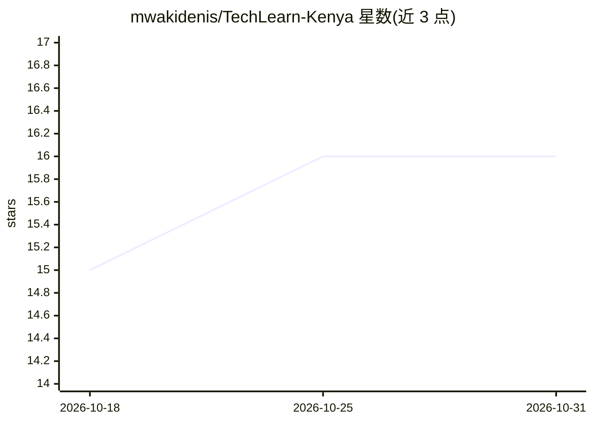

# mwakidenis/TechLearn-Kenya

⭐ 16 · TypeScript · 推送 2026-10-28 · [GitHub](https://github.com/mwakidenis/TechLearn-Kenya) · [官网](https://tech-genesis-academy.vercel.app/) · 个人维护

**面向非洲青年的在线学习管理系统，含 AI 助学与 M-PESA 支付**

React/TypeScript/Vite 前端 + Supabase/PostgreSQL 后端的学习管理系统，提供 7 门免费与 11 门付费技术课程、证书、就业板块与社区功能。AI 部分：基于 OpenAI GPT 的对话式学习助手、学习分析与推荐系统。支付集成了 Safaricom M-PESA STK Push 与 Stripe，支持肯尼亚先令定价。运行需 Node.js 18+、Supabase 账号、Safaricom 开发者账号与 OpenAI API Key，克隆仓库并配置 .env.local 后本地部署。

## 筛选速览

| 维度 | 判定 | 备注 |
|---|---|---|
| AI 角色 | `ai-enhanced` | 去掉 AI 部分产品仍成立 |
| 许可风险 | `none` | — |
| 部署形态 | `None` |  |
| 模型依赖 | — | README 未给出锁定关系 |
| 硬件要求 | — | 无带数字的原话,不猜 |
| 安装摩擦 | `low` | 无编译、无系统依赖或容器化 |
| 成熟度 | — | 结构信号不足 |

## 能力要点

- OpenAI GPT 集成的对话式学习助手与分析引擎
- M-PESA STK Push 支付与自动课程开通
- 7 门免费 + 11 门付费课程及证书体系
- USSD 无网络求职申请与企业合作就业板块

## 适用场景

- 非洲学生在线学习技术课程并获证书
- 通过 M-PESA 移动支付购买付费课程
- 通过 AI 助手获得个性化学习建议与答疑

## 场景标签

`AI 助手` · 领域:对话与助手

## 证据(README 行号)

> L28: ### 🤖 **Revolutionary AI Study Assistant** - *Our Competitive Edge*
> L46: ### 🎓 **Comprehensive Learning Experience**

## 星数曲线

2026-10-18 15 → 2026-10-31 16（+1）

---
*卡片 v1 · prompt 1.4 · 生成 2026-10-30 · 置信度 mid · 依据 README sha `2bb2cae5a838` · [字段定义](../../DATASET.md)*
