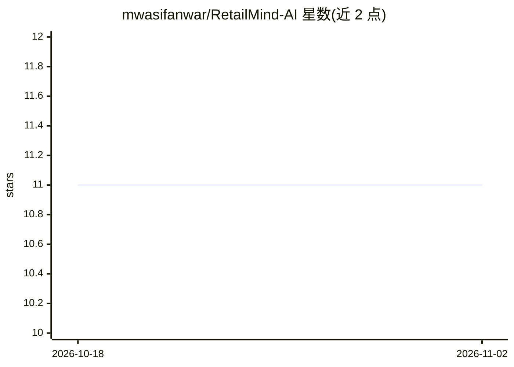

# mwasifanwar/RetailMind-AI

⭐ 11 · Python · 推送 2025-11-06 · [GitHub](https://github.com/mwasifanwar/RetailMind-AI) · [官网](https://mwasif.dev) · 个人维护

**面向实体零售的 AI 分析平台：视觉追踪顾客、管理库存、推荐**

面向零售商的实体店分析平台：从 CCTV 视频流、POS 交易与 IoT 传感器采集数据，经 YOLOv8 目标检测、卡尔曼滤波跟踪与深度度量 Re-ID 实现多摄像头顾客追踪；用货架占用率与指数平滑预测补货；用带多头注意力的 Transformer 生成序列化商品推荐；用 GMM 与孤立森林做客群聚类和异常行为检测。后端为 FastAPI/Flask，提供仪表盘与 REST API。安装需 clone 仓库、建虚拟环境、pip 装依赖并下载预训练模型，要求 NVIDIA GPU 8GB+ VRAM。

## 筛选速览

| 维度 | 判定 | 备注 |
|---|---|---|
| AI 角色 | `ai-native` | 本体是模型或模型工具 |
| 许可风险 | `none` | — |
| 部署形态 | `self-host` | docker 或自建部署 |
| 模型依赖 | — | README 未给出锁定关系 |
| 硬件要求 | — | 无带数字的原话,不猜 |
| 安装摩擦 | `low` | 无编译、无系统依赖或容器化 |
| 成熟度 | — | 结构信号不足 |

## 能力要点

- YOLOv8 检测 + 卡尔曼滤波跟踪 + 深度余弦度量 Re-ID 的多摄像头顾客追踪
- Transformer 多头注意力序列推荐引擎
- 货架占用率计算与指数平滑需求的补货预测
- GMM 客群聚类与孤立森林异常行为检测

## 适用场景

- 追踪店内顾客动线、停留时长与排队情况并生成热力图
- 自动监测货架库存并收到缺货与补货提醒
- 基于购买序列为顾客生成个性化商品推荐
- 分析门店布局瓶颈并优化商品摆放

## 场景标签

`目标检测` `推荐系统` `数据分析` · 领域:效率与自动化

## 证据(README 行号)

> L10:  RetailMind is an advanced AI-powered retail analytics platform that transforms physical retail spaces into intelli
> L33:  Computer Vision Engine : Implements YOLO-based object detection for customer tracking, product recognition using c
> L36:  Recommendation Engine : Generates personalized product recommendations using transformer architectures with attent

## 星数曲线

2026-10-18 11 → 2026-11-02 11（+0）

---
*卡片 v1 · prompt 1.4 · 生成 2026-11-01 · 置信度 low · 依据 README sha `d12e60fee36b` · [字段定义](../../DATASET.md)*
