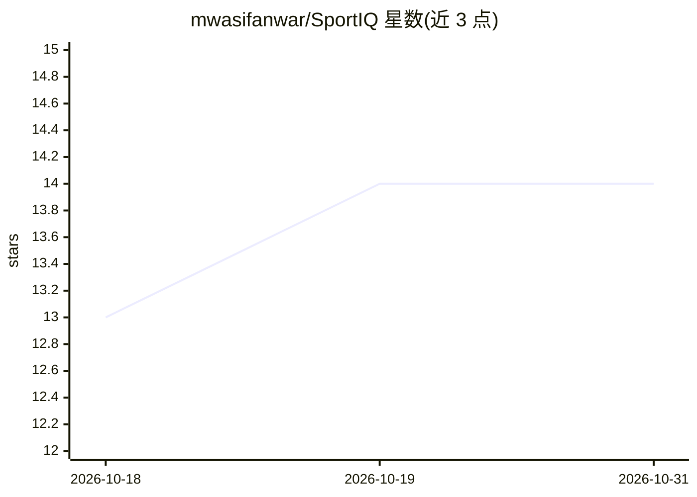

# mwasifanwar/SportIQ

⭐ 14 · Python · 推送 2025-11-10 · [GitHub](https://github.com/mwasifanwar/SportIQ) · [官网](https://www.linkedin.com/in/mwasifanwar/) · 个人维护

**分析运动视频的计算机视觉系统：姿态估计与运动表现指标**

SportIQ 是处理运动视频的计算机视觉分析平台：流水线依次执行球员检测、多人姿态估计（17 关键点）、Kalman 滤波跟踪、生物力学关节角度计算，输出运动表现指标、伤病风险评估与战术分析；提供 CLI、Python API、REST API 与交互式可视化。技术栈基于 PyTorch、OpenCV、Scikit-learn、Flask。输入支持摄像头、视频文件与广播流；实时处理需 NVIDIA GPU（8GB+ 显存）与 CUDA 11.1+，16GB 内存起步。面向教练、运动员与体育科研人员。

## 筛选速览

| 维度 | 判定 | 备注 |
|---|---|---|
| AI 角色 | `ai-native` | 本体是模型或模型工具 |
| 许可风险 | `none` | — |
| 部署形态 | `self-host` | docker 或自建部署 |
| 模型依赖 | — | README 未给出锁定关系 |
| 硬件要求 | — | 无带数字的原话,不猜 |
| 安装摩擦 | `low` | 无编译、无系统依赖或容器化 |
| 成熟度 | — | 结构信号不足 |

## 能力要点

- 多人实时姿态估计（17 关键点）与 Kalman 滤波跟踪
- 生物力学分析：关节角度、速度/加速度剖面与伤病风险预测
- 战术分析：阵型识别、球员角色与移动模式
- 提供 CLI、Python API、REST API 与 Docker 部署

## 适用场景

- 分析训练或比赛录像，生成量化表现报告
- 通过伤病风险模型监测运动员疲劳与受伤概率
- 对球队比赛做阵型与战术模式分析
- 接入摄像头实时分析并在仪表盘查看反馈

## 场景标签

`图像视频处理` · 领域:感知与多模态

## 证据(README 行号)

> L24: Video Input → Player Detection → Multi-person Pose Estimation → Motion Tracking → Biomechanical Analysis → Performa
> L105:  Multi-person Pose Estimation: Real-time detection of 17 key body joints with sub-pixel accuracy
> L107:  Injury Risk Assessment: Machine learning models predicting fatigue and injury probability

## 星数曲线

2026-10-18 13 → 2026-10-31 14（+1）

---
*卡片 v1 · prompt 1.4 · 生成 2026-10-31 · 置信度 high · 依据 README sha `f558970848d6` · [字段定义](../../DATASET.md)*
