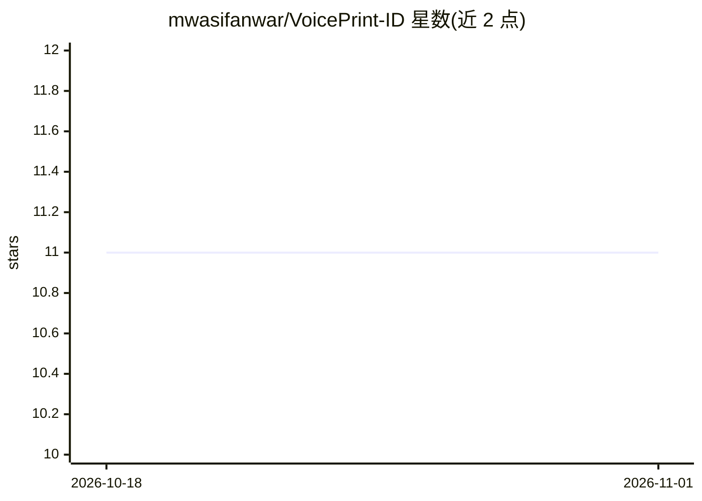

# mwasifanwar/VoicePrint-ID

⭐ 11 · Python · 推送 2025-11-06 · [GitHub](https://github.com/mwasifanwar/VoicePrint-ID) · [官网](https://mwasif.dev) · 个人维护

**深度学习多说话人声纹识别与验证系统，含情感/语言/防伪**

基于 TensorFlow 的语音生物识别系统：通过 MFCC/Mel 频谱特征提取与多分支 CNN/LSTM 网络，提供说话人识别与验证、七类情感识别、十语种语言识别、重放/合成/语音转换等欺骗攻击检测，以及降噪与语音活动检测。训练采用 ArcFace 角度 softmax 损失与多任务联合目标。面向高安全认证、呼叫中心分析与取证语音分析场景，提供 FastAPI REST 接口、WebSocket 实时流与 Flask 网页面板。安装为 git clone 源码方式，需 Python 3.8+、8GB 内存，GPU 为可选。

## 筛选速览

| 维度 | 判定 | 备注 |
|---|---|---|
| AI 角色 | `ai-native` | 本体是模型或模型工具 |
| 许可风险 | `none` | — |
| 部署形态 | `self-host` | docker 或自建部署 |
| 模型依赖 | — | README 未给出锁定关系 |
| 硬件要求 | — | 无带数字的原话,不猜 |
| 安装摩擦 | `low` | 无编译、无系统依赖或容器化 |
| 成熟度 | — | 结构信号不足 |

## 能力要点

- 多任务 CNN/LSTM 架构：说话人嵌入、情感、语言、欺骗检测并行
- ArcFace 损失训练与注意力/集成决策融合
- 检测重放、合成、语音转换等欺骗攻击与深度伪造语音
- REST API + WebSocket 实时流 + Web 仪表盘

## 适用场景

- 用声纹做高安全场景的身份验证
- 呼叫中心录音的说话人识别与情感分析
- 语音取证与多说话人分离场景分析

## 场景标签

`网络安全` · 领域:学习与行业

## 证据(README 行号)

> L38:  Multi-Task Neural Network Architecture : Employs specialized CNN and LSTM networks for speaker embedding, emotion 
> L175:  Multiple spoofing attack detection: replay, synthesis, voice conversion, impersonation

## 星数曲线

2026-10-18 11 → 2026-11-01 11（+0）

---
*卡片 v1 · prompt 1.4 · 生成 2026-11-01 · 置信度 low · 依据 README sha `b115e81a38da` · [字段定义](../../DATASET.md)*
