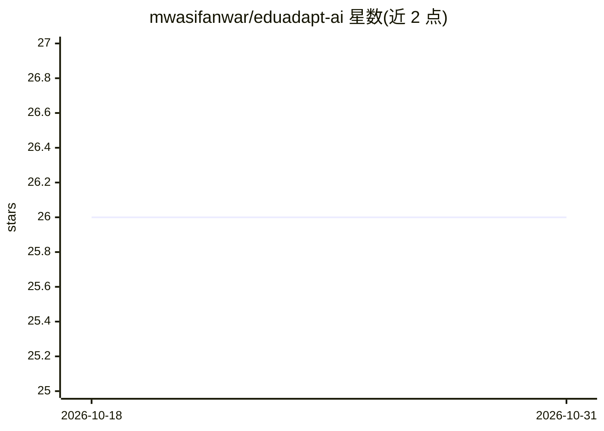

# mwasifanwar/eduadapt-ai

⭐ 26 · Python · 推送 2025-11-07 · [GitHub](https://github.com/mwasifanwar/eduadapt-ai) · [官网](https://mwasif.dev) · 个人维护

**自适应学习平台：按学生表现与学习风格个性化推荐学习路径**

面向 K-12、高校与企业培训的自适应学习系统，整合三大模块：LSTM 知识追踪（建模学生概念掌握状态）、个性化内容推荐（TF-IDF 语义分析与学习风格匹配的加权评分）、强化学习优化器（策略梯度调整学习路径）。另含自适应测验生成（难度随表现缩放）、学习进度分析与 FastAPI 实时推荐服务。通过 git clone、conda 环境与 pip 安装，提供模型训练、平台运行与学习模拟脚本；PyTorch CUDA 支持为可选加速项。配置以 YAML 组织，区分 K-12/高教/企业培训/自学四种模式。

## 筛选速览

| 维度 | 判定 | 备注 |
|---|---|---|
| AI 角色 | `ai-native` | 本体是模型或模型工具 |
| 许可风险 | `none` | — |
| 部署形态 | `library` | 以包/库形式分发 |
| 模型依赖 | — | README 未给出锁定关系 |
| 硬件要求 | — | 无带数字的原话,不猜 |
| 安装摩擦 | `medium` | 含编译或系统依赖之一 |
| 成熟度 | — | 结构信号不足 |

## 能力要点

- LSTM 知识追踪建模学生概念掌握与知识演化
- 策略梯度强化学习优化学习路径推荐
- 四类学习风格自动检测与多模态内容匹配
- 自适应测验生成与难度缩放（掌握阈值 0.8）

## 适用场景

- 为班级或企业培训生成个性化学习路径与内容推荐
- 追踪学生概念掌握、技能缺口与学习速度
- 通过 REST API 将推荐服务接入已有教育平台
- 用模拟脚本生成学习数据并压测推荐系统

## 场景标签

`推荐系统` · 领域:学习与行业

## 证据(README 行号)

> L56:  Deep Learning Framework: PyTorch with LSTM networks for knowledge tracing
> L57:  Reinforcement Learning: Custom policy gradient methods for learning path optimization
> L98:  Dynamic Knowledge Tracing: Real-time tracking of student concept mastery using LSTM networks

## 星数曲线

2026-10-18 26 → 2026-10-31 26（+0）

---
*卡片 v1 · prompt 1.4 · 生成 2026-10-26 · 置信度 high · 依据 README sha `aadbdf1d6603` · [字段定义](../../DATASET.md)*
