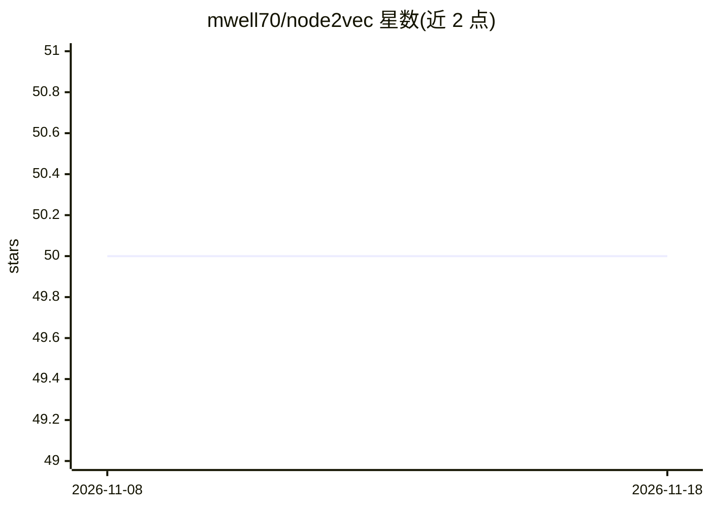

# mwell70/node2vec

⭐ 50 · Python · MIT · 推送 2026-11-05 · [GitHub](https://github.com/mwell70/node2vec) · 个人维护

**node2vec 算法的 Python 实现：为网络节点生成向量嵌入**

node2vec 算法（Grover & Leskovec, KDD 2016）的 Python3 实现，通过有偏随机游走与 skip-gram 为图节点学习特征表示。输入为 networkx 图，参数涵盖维度、游走长度、p/q 超参数、节点级采样策略与并行 worker 等；fit 方法接受 gensim.Word2Vec 的任意关键字参数。另提供 Average/Hadamard/WeightedL1/WeightedL2 四种边嵌入类。限制：Windows 下并行执行不可用（joblib 已知问题）；README 声明维护者已无时间维护。

## 筛选速览

| 维度 | 判定 | 备注 |
|---|---|---|
| AI 角色 | `ai-native` | 本体是模型或模型工具 |
| 许可风险 | `permissive` | MIT |
| 部署形态 | `library` | 以包/库形式分发 |
| 模型依赖 | — | README 未给出锁定关系 |
| 硬件要求 | — | 无带数字的原话,不猜 |
| 安装摩擦 | `low` | 无编译、无系统依赖或容器化 |
| 成熟度 | — | 结构信号不足 |

## 能力要点

- 基于有偏随机游走与 skip-gram 的节点嵌入生成
- 支持节点级 p/q/num_walks/walk_length 采样策略
- 提供 4 种边嵌入类（Average/Hadamard/WeightedL1/WeightedL2）
- fit 方法透传 gensim.Word2Vec 关键字参数

## 适用场景

- 为图节点生成向量表示以做下游机器学习任务
- 对图中任意节点对计算边嵌入
- 在大图上通过共享内存临时目录与并行游走生成嵌入

## 场景标签

`向量数据库` · 领域:知识与检索

## 证据(README 行号)

> L4: Python3 implementation of the node2vec algorithm Aditya Grover, Jure Leskovec and Vid Kocijan.
> L48: The classes are `AverageEmbedder`, `HadamardEmbedder`, `WeightedL1Embedder` and `WeightedL2Embedder` which their pr

## 星数曲线

2026-11-08 50 → 2026-11-18 50（+0）

---
*卡片 v1 · prompt 1.4 · 生成 2026-11-18 · 置信度 high · 依据 README sha `418a876dba98` · [字段定义](../../DATASET.md)*
