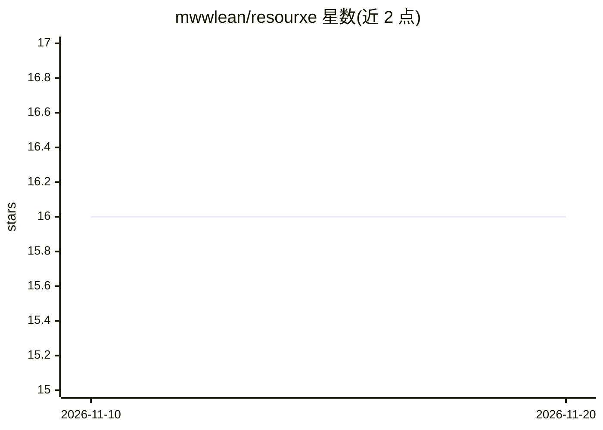

# mwwlean/resourxe

⭐ 16 · TypeScript · MIT · 推送 2026-11-09 · [GitHub](https://github.com/mwwlean/resourxe) · 个人维护

**开发者工具策展清单：1573 条资源覆盖编程、设计与构建**

一个以 Markdown 表格组织的开发者工具策展清单，收录 1573 条资源，按编程语言、框架、CSS、数据库、设计原型、测试、API 开发、云服务、版本控制、部署、生产力、配色与图标等类别分章，每条含网站链接与一句描述。面向开发者、AI 构建者与设计人员，用于查找工具。部分条目涉及 AI 工具（如 AI 编程助手、AI 测试工具），README 后段（可见范围外）含 AI 工具章节。无安装与运行方式，属静态清单仓库。

## 筛选速览

| 维度 | 判定 | 备注 |
|---|---|---|
| AI 角色 | `ai-knowledge` | 知识聚合/清单类 |
| 许可风险 | `permissive` | MIT |
| 部署形态 | `None` |  |
| 模型依赖 | — | README 未给出锁定关系 |
| 硬件要求 | — | 无带数字的原话,不猜 |
| 安装摩擦 | `low` | 无编译、无系统依赖或容器化 |
| 成熟度 | — | 结构信号不足 |

## 能力要点

- 1573 条手工挑选的开发者资源
- 按 20+ 个类别组织，每条含链接与描述
- 覆盖语言、框架、数据库、部署、生产力工具等开发全链路

## 适用场景

- 查找某类开发任务对应的工具选项
- 为新项目选型时浏览框架、数据库与部署平台清单
- 发现设计与配色类辅助工具

## 场景标签

`精选清单` · 领域:学习与行业

## 证据(README 行号)

> L3: A curated list of developer tools to help you code, design, and build faster.
> L4: 1573 hand-picked resources for developers, AI builders, and creatives.

## 星数曲线

2026-11-10 16 → 2026-11-20 16（+0）

---
*卡片 v1 · prompt 1.4 · 生成 2026-11-18 · 置信度 high · 依据 README sha `efadc74f2eed` · [字段定义](../../DATASET.md)*
