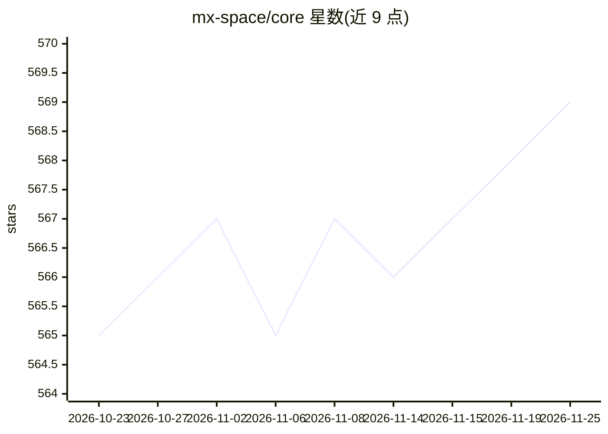

# mx-space/core

⭐ 569 · TypeScript · NOASSERTION · 推送 2026-11-23 · [GitHub](https://github.com/mx-space/core) · 个人维护

**面向个人博客与创作者网站的 AI 增强 headless CMS 服务端**

Mix Space 是个人 CMS 全栈的 monorepo，包含 NestJS + Fastify + PostgreSQL + Redis 的 headless CMS 服务端、React 管理后台、原生 iOS 管理客户端、Rust 编写的 APNs 推送中继与遥测采集器，并提供 TypeScript SDK、CLI、编辑器契约与 webhook 包。AI 相关能力包括文章摘要、翻译、审核与写作工作流，AI 事件契约通过共享包统一给服务端与客户端使用。快速启动使用 corepack + pnpm 从源码安装，各应用另有独立部署文档；历史 MongoDB → PostgreSQL 迁移以独立 npm 包发布。

## 筛选速览

| 维度 | 判定 | 备注 |
|---|---|---|
| AI 角色 | `ai-enhanced` | 去掉 AI 部分产品仍成立 |
| 许可风险 | `none` | NOASSERTION |
| 部署形态 | `self-host` | docker 或自建部署 |
| 模型依赖 | — | README 未给出锁定关系 |
| 硬件要求 | — | 无带数字的原话,不猜 |
| 安装摩擦 | `low` | 无编译、无系统依赖或容器化 |
| 成熟度 | — | 结构信号不足 |

## 能力要点

- 服务端为 NestJS + Fastify + PostgreSQL + Redis 的 headless CMS
- AI 摘要、翻译、审核与写作工作流，AI 事件契约共享包
- 单仓库交付服务端、管理后台、iOS 客户端与推送中继
- 提供类型化 api-client SDK 与带 OIDC 设备认证的所有者 CLI

## 适用场景

- 搭建个人博客与创作者主页的内容管理后台
- 为内容站接入 AI 摘要与翻译工作流
- 多端（Web/iOS）共享同一 CMS 后端与推送通道

## 场景标签

`AI 写作` · 领域:内容生成

## 证据(README 行号)

> L18: Mix Space is an AI-powered, headless CMS for personal blogs, creator homepages, and
> L35: |`apps/core`|`@mx-space/core`|The heart of the stack — AI-powered headless CMS server (NestJS + Fastify + PostgreSQ
> L105: AGPLv3 + MIT — see `ADDITIONAL_TERMS.md`.

## 星数曲线

2026-10-23 565 → 2026-11-25 569（+4）

---
*卡片 v1 · prompt 1.4 · 生成 2026-11-25 · 置信度 mid · 依据 README sha `9e69405c750d` · [字段定义](../../DATASET.md)*
