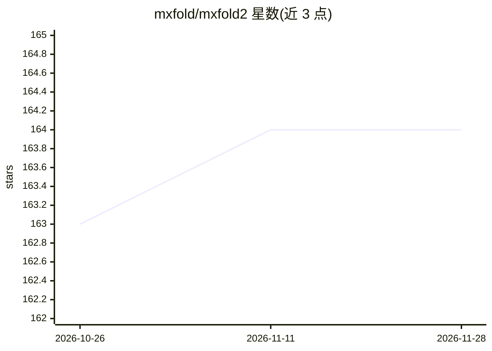

# mxfold/mxfold2

⭐ 164 · Python · MIT · 推送 2026-11-20 · [GitHub](https://github.com/mxfold/mxfold2) · 组织维护

**为科研人员从 RNA 序列预测二级结构的深度学习工具**

MXfold2 是一个 RNA 二级结构预测命令行工具：将神经网络评分与热力学参数结合来判定碱基配对，从 FASTA 序列输出点括号记法的结构及分数，可另写 BPSEQ 文件。内置预训练模型（nr80_imle_rank），也支持用已知结构或化学探测数据（SHAPE/DMS）训练与微调模型。通过 PyPI 或源码安装，支持 CUDA GPU 加速，无 GPU 时可用 CPU 路径运行小示例，另有网页版界面。

## 筛选速览

| 维度 | 判定 | 备注 |
|---|---|---|
| AI 角色 | `ai-native` | 本体是模型或模型工具 |
| 许可风险 | `permissive` | MIT |
| 部署形态 | `library` | 以包/库形式分发 |
| 模型依赖 | — | README 未给出锁定关系 |
| 硬件要求 | — | 无带数字的原话,不猜 |
| 安装摩擦 | `high` | 编译与系统依赖俱全 |
| 成熟度 | — | 结构信号不足 |

## 能力要点

- 神经网络评分与热力学参数结合的 RNA 二级结构预测
- 内置 nr80_imle_rank 预训练模型，FASTA 直接输入
- 支持用已知结构、SHAPE/DMS 化学探测数据训练与微调
- 提供 predict/train 子命令 CLI 与网页版界面

## 适用场景

- 从 FASTA 序列批量预测 RNA 二级结构
- 用实验室的化学探测数据微调预测模型
- 复现论文默认模型的训练流程

## 场景标签

`科研工具` `微调` · 领域:学习与行业

## 证据(README 行号)

> L3: MXfold2 predicts RNA secondary structure from sequence. It combines scores from
> L4: a neural network with thermodynamic parameters to choose which bases pair.
> L53: mxfold2 predict example.fa

## 星数曲线

2026-10-26 163 → 2026-11-28 164（+1）

---
*卡片 v1 · prompt 1.4 · 生成 2026-11-27 · 置信度 high · 依据 README sha `9194ae5bb83e` · [字段定义](../../DATASET.md)*
