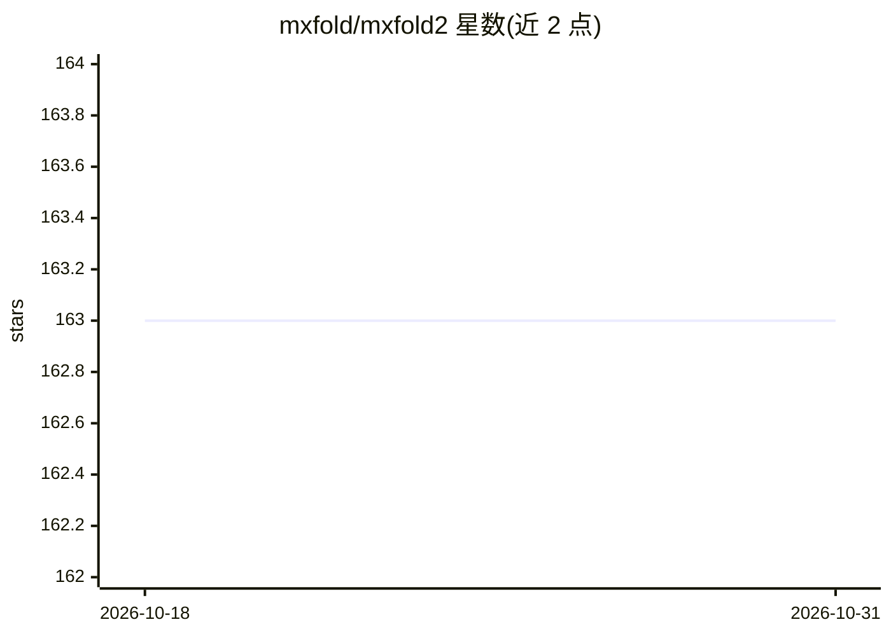

# mxfold/mxfold2

⭐ 163 · Python · MIT · 推送 2026-10-26 · [GitHub](https://github.com/mxfold/mxfold2) · 组织维护

**给生物研究者的 RNA 二级结构预测工具：深度学习+热力学积分**

MXfold2 是 RNA 二级结构预测软件，采用深度学习与热力学参数积分的方法，读取 FASTA 格式的 RNA 序列，输出带能量值的二级结构。默认使用 TrainSetA/TrainSetB 训练的参数，另提供论文中其他预训练模型；支持从 BPSEQ 格式数据训练自定义参数（如 MixC 模型）。以 Python 包提供，可通过 wheel 或源码分发安装，从源码构建需要 C++17 编译器；另有 Keio 大学托管的在线服务器。方法发表于 Nature Communications 2021。

## 筛选速览

| 维度 | 判定 | 备注 |
|---|---|---|
| AI 角色 | `ai-native` | 本体是模型或模型工具 |
| 许可风险 | `permissive` | MIT |
| 部署形态 | `library` | 以包/库形式分发 |
| 模型依赖 | — | README 未给出锁定关系 |
| 硬件要求 | — | 无带数字的原话,不猜 |
| 安装摩擦 | `medium` | 含编译或系统依赖之一 |
| 成熟度 | — | 结构信号不足 |

## 能力要点

- 深度学习与热力学积分的 RNA 二级结构预测
- 提供预训练模型与自定义训练功能（mxfold2 train）
- 命令行读取 FASTA 序列并输出结构
- 提供在线 web 服务器

## 适用场景

- 我需要预测给定 RNA 序列的二级结构
- 我想用自己的 BPSEQ 数据训练预测模型
- 我不想本地安装，直接在网页服务器上预测

## 场景标签

 · 领域:生物信息学/RNA 结构预测

## 证据(README 行号)

> L2: RNA secondary structure prediction using deep learning with thermodynamic integration
> L29:  % mxfold2 predict test.fa

## 星数曲线

2026-10-18 163 → 2026-10-31 163（+0）

---
*卡片 v1 · prompt 1.4 · 生成 2026-10-22 · 置信度 high · 依据 README sha `295b3fc0b184` · [字段定义](../../DATASET.md)*
