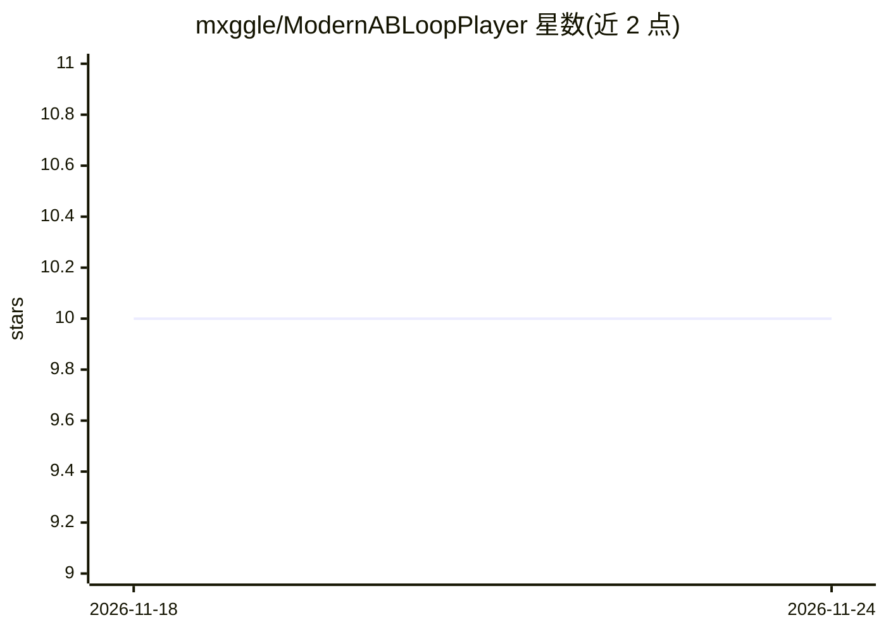

# mxggle/ModernABLoopPlayer

⭐ 10 · TypeScript · 推送 2026-04-16 · [GitHub](https://github.com/mxggle/ModernABLoopPlayer) · [官网](https://loopmate.harrysui.me/) · 个人维护

**给语言学习者与音乐人的 A-B 循环播放跟读录音 Web 应用**

LoopMate 是一个 Web 端音视频循环播放器，面向语言学习者、音乐人和内容审阅者：支持本地文件拖放与 YouTube 链接，可设置 A-B 循环点并微调、波形可视化导航、0.25x–2.0x 变速不变调、带笔记的书签。Shadowing 模式在播放时录制用户语音，双波形叠加显示、自动静音防回声、非破坏性 punch-in 修剪，并支持移动端。所有文件与录音存储在浏览器 IndexedDB，不上传服务器。技术栈为 React 18/TypeScript/Vite，需 Node.js 16+ 本地运行。

## 筛选速览

| 维度 | 判定 | 备注 |
|---|---|---|
| AI 角色 | `ai-enhanced` | 去掉 AI 部分产品仍成立 |
| 许可风险 | `none` | — |
| 部署形态 | `library` | 以包/库形式分发 |
| 模型依赖 | — | README 未给出锁定关系 |
| 硬件要求 | — | 无带数字的原话,不猜 |
| 安装摩擦 | `low` | 无编译、无系统依赖或容器化 |
| 成熟度 | — | 结构信号不足 |

## 能力要点

- A-B 循环点设置与波形可视化精确导航
- Shadowing 录音模式：双波形叠加、自动静音、非破坏性修剪
- 0.25x–2.0x 变速不变调与带笔记书签
- 本地存储（IndexedDB），不上传服务器

## 适用场景

- 循环播放语言材料做跟读影子练习
- 音乐人分段循环练习乐句并录音对比
- 给音频重要时间点加笔记书签以便回看

## 场景标签

 · 领域:教育/语言学习工具

## 证据(README 行号)

> L5: LoopMate is a sleek and intuitive web app designed for language learners, musicians, and content reviewers. It allow
> L37: - **Privacy First**: All local files and recordings are stored locally in your browser (IndexedDB). Nothing is uplo
> L41: - **Frontend**: React 18, TypeScript, Vite

## 星数曲线

2026-11-18 10 → 2026-11-24 10（+0）

---
*卡片 v1 · prompt 1.4 · 生成 2026-11-19 · 置信度 high · 依据 README sha `c46808211d47` · [字段定义](../../DATASET.md)*
