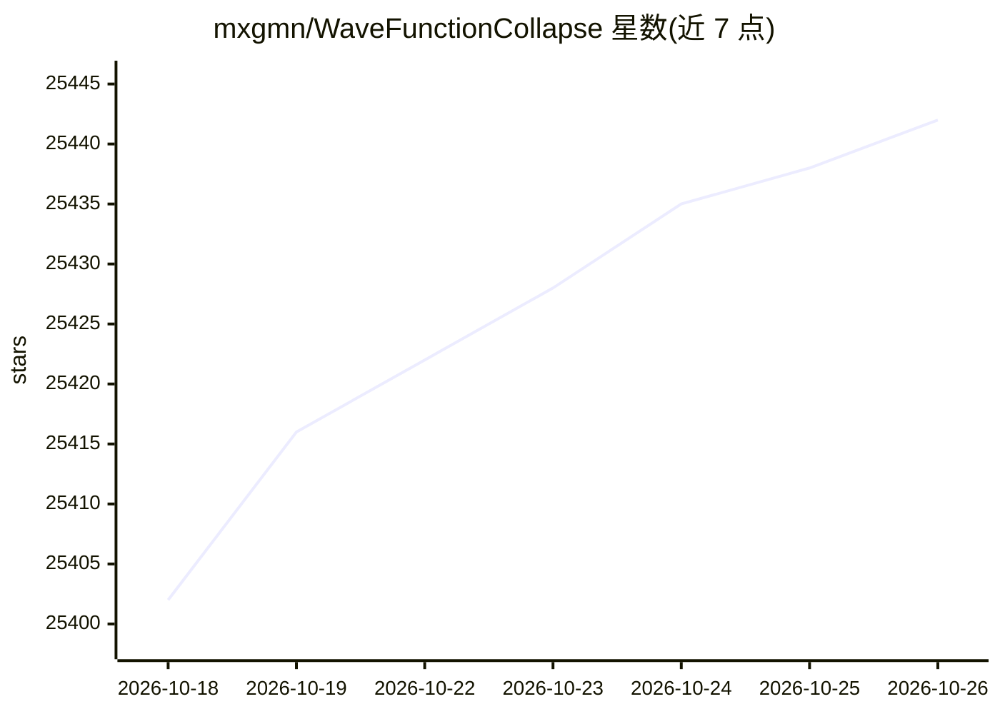

# mxgmn/WaveFunctionCollapse

⭐ 25,442 · C# · NOASSERTION · 推送 2026-10-15 · [GitHub](https://github.com/mxgmn/WaveFunctionCollapse) · 个人维护

**从单个示例图生成局部相似位图与瓦片地图的程序**

用 C# 编写的控制台程序，读取输入位图并统计 NxN 图案，通过观察-传播循环生成与输入局部相似的位图或瓦片地图；仅依赖标准库，通过 .NET Core 以 dotnet run 构建，输出写入 output 文件夹，参数经 samples.xml 配置。可用的另一种途径包括 Windows 官方 release、itch.io 图形版与浏览器运行。README 记录该算法已被移植到十余种语言与 Unity/Unreal/Godot 等引擎，并被多款游戏用于生成关卡；同时说明算法可能陷入矛盾而无法继续（判定问题为 NP-hard）。

## 筛选速览

| 维度 | 判定 | 备注 |
|---|---|---|
| AI 角色 | `ai-knowledge` | 知识聚合/清单类 |
| 许可风险 | `none` | NOASSERTION |
| 部署形态 | `desktop` | 安装包/桌面程序 |
| 模型依赖 | — | README 未给出锁定关系 |
| 硬件要求 | — | 无带数字的原话,不猜 |
| 安装摩擦 | `medium` | 含编译或系统依赖之一 |
| 成熟度 | — | 结构信号不足 |

## 动量与使用信号

- 维护:`active` — 距上次 push 2.8 天,年发版 0,19 位贡献者
- 涨星:近 1 天 **+3**(自 20261016 起算)
- 平台:WINDOWS · 协议:—

## 能力要点

- 以观察-传播循环生成与输入局部相似的位图，输出只含输入中出现过的 NxN 图案
- 支持瓦片模型：以瓦片列表与邻接数据初始化，含瓦片对称性系统以缩短邻接枚举
- 支持约束条件，可与人工创建或其他生成算法组合使用
- 支持更高维度（体素模型）与时间维

## 适用场景

- 根据一张示例像素图生成风格一致的位图纹理
- 为游戏生成瓦片地图关卡
- 在人工开始的关卡上用算法自动补全
- 生成 3D 体素模型

## 场景标签

 · 领域:程序化生成/游戏开发算法

## 证据(README 行号)

> L2: This program generates bitmaps that are locally similar to the input bitmap.
> L14: WFC initializes output bitmap in a completely unobserved state, where each pixel value is in superposition of color
> L68: 1. Read the input bitmap and count NxN patterns.

## 星数曲线

2026-10-18 25,402 → 2026-10-26 25,442（+40）

---
*卡片 v1 · prompt 1.4 · 生成 2026-10-18 · 置信度 mid · 依据 README sha `eb2a3f59ea37` · [字段定义](../../DATASET.md)*
