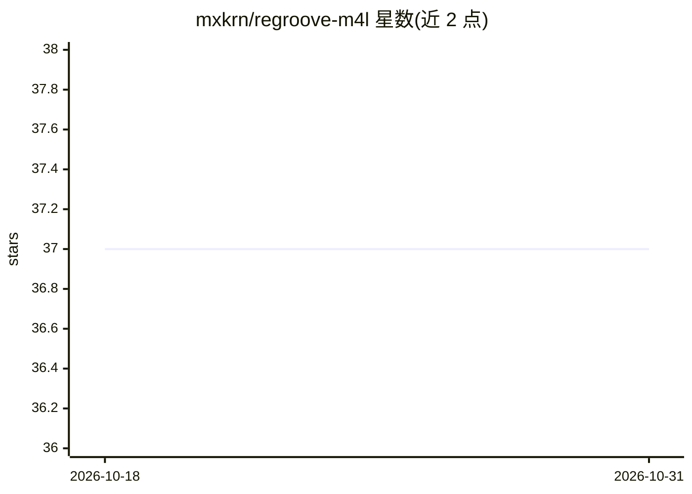

# mxkrn/regroove-m4l

⭐ 37 · Max · 推送 2025-12-23 · [GitHub](https://github.com/mxkrn/regroove-m4l) · [官网](https://koil.re/regroove) · 组织维护

**Max for Live 设备：用深度学习生成带律动表现力的鼓节奏**

运行于 Ableton Live（Max for Live）的鼓节奏生成设备。其算法从职业鼓手在 9 件套鼓组上演奏的大量鼓序列中学习律动表示，涵盖力度、微时值与切分音，按此表示生成鼓节奏供用户编辑。需 Max 8.3 或更高版本，加载时需 5-30 秒将大型深度学习模型读入内存。模型通过 ONNX 在 Node for Max 运行时中执行；模型文件未公开，源码无法自行编译为可用设备。

## 筛选速览

| 维度 | 判定 | 备注 |
|---|---|---|
| AI 角色 | `ai-native` | 本体是模型或模型工具 |
| 许可风险 | `none` | — |
| 部署形态 | `None` |  |
| 模型依赖 | — | README 未给出锁定关系 |
| 硬件要求 | — | 无带数字的原话,不猜 |
| 安装摩擦 | `low` | 无编译、无系统依赖或容器化 |
| 成熟度 | — | 结构信号不足 |

## 能力要点

- 从职业鼓手鼓序列数据学习律动表示（力度/微时值/切分音）
- 以 Max for Live 设备形式在 Ableton Live 内运行
- 模型以 ONNX 格式经 onnxruntime-node 在 Node for Max 运行时中执行

## 适用场景

- 在 Ableton Live 中生成有表现力的鼓节奏
- 像职业鼓手那样对鼓的律动进行控制

## 场景标签

 · 领域:音乐创作/AI 生成

## 证据(README 行号)

> L5: **Regroove** is a `Max for Live` device that generates expressive drum rhythms using a learning understanding of gro
> L25: It's normal that the device takes anywhere between 5 - 30 seconds to load, the actual time depends on your machine 
> L29: The code uses an ONNX model which we can run using the `onnxruntime-node` package inside the Node for Max runtime. 

## 星数曲线

2026-10-18 37 → 2026-10-31 37（+0）

---
*卡片 v1 · prompt 1.4 · 生成 2026-10-25 · 置信度 high · 依据 README sha `af061143d253` · [字段定义](../../DATASET.md)*
