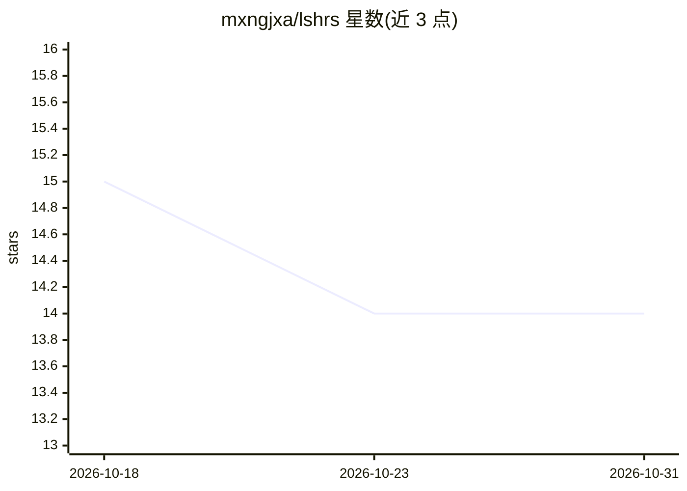

# mxngjxa/lshrs

⭐ 14 · Python · MIT · 推送 2026-06-08 · [GitHub](https://github.com/mxngjxa/lshrs) · 个人维护

**基于 LSH 的余弦近似最近邻检索工具包，Redis 存桶索引**

Python 工具包：用带状随机投影签名实现 LSH 工作流，Redis 只存 bucket→索引集合的紧凑成员关系，向量本体保留在外部数据存储（PostgreSQL/pgvector、Parquet、对象存储等），按需取回做余弦重排。支持从 PostgreSQL（服务端游标）或 Parquet 流式摄取，自动选择 bands/rows，提供 Top-k 与 Top-p 两种检索模式、按 id 精确删除（适配 GDPR 场景）、投影矩阵持久化与可复现基准。需 Python>=3.10。

## 筛选速览

| 维度 | 判定 | 备注 |
|---|---|---|
| AI 角色 | `ai-ecosystem` | LLM/agent 周边工具 |
| 许可风险 | `permissive` | MIT |
| 部署形态 | `library` | 以包/库形式分发 |
| 模型依赖 | — | README 未给出锁定关系 |
| 硬件要求 | — | 无带数字的原话,不猜 |
| 安装摩擦 | `low` | 无编译、无系统依赖或容器化 |
| 成熟度 | — | 结构信号不足 |

## 能力要点

- 向量留在外部数据存储，Redis 仅存桶成员索引
- Top-k（延迟优先）与 Top-p（余弦重排）两种检索模式
- PostgreSQL 服务端游标 / Parquet 流式摄取
- 按 id 精确删除无需重建或压实，适配 GDPR 场景

## 适用场景

- 在既有数据库上加装余弦 ANN 检索而不迁移向量
- RAG 系统中的候选召回层，控制 Redis 内存占用
- 需要按数据主体删除向量的合规场景

## 场景标签

`向量数据库` · 领域:知识与检索

## 证据(README 行号)

> L10: Redis-backed locality-sensitive hashing toolkit that stores bucket membership in Redis while keeping the heavy vect
> L18: LSHRS adds cosine approximate-nearest-neighbor (ANN) search on top of the datastore you already run. Redis holds *o

## 星数曲线

2026-10-18 15 → 2026-10-31 14（-1）

---
*卡片 v1 · prompt 1.4 · 生成 2026-10-31 · 置信度 high · 依据 README sha `b1455e49385f` · [字段定义](../../DATASET.md)*
