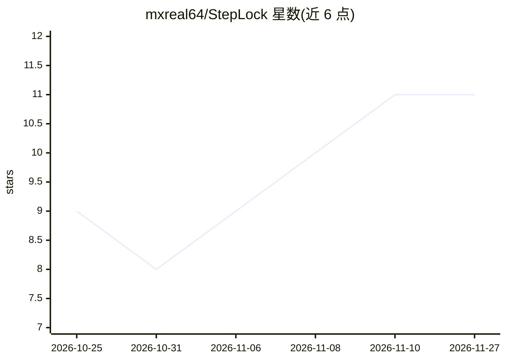

# mxreal64/StepLock

⭐ 11 · C# · Apache-2.0 · 推送 2026-10-11 · [GitHub](https://github.com/mxreal64/StepLock) · 个人维护

**AI Agent 执行的确定性录制回放代理与 Merkle DAG 引擎**

面向多步 Agent 工作流的确定性状态代理与 Merkle DAG 执行引擎，以 .NET 11 实现，通过 Python 与 TypeScript SDK 接入。将每次执行步骤记录为密码学 Merkle DAG，支持时间旅行分支（fork）、网络包虚拟化回放、副作用拦截（Stripe/邮件/DB 写入合成响应）与 PII/密钥实时脱敏。提供本地 Dashboard 与基准测试项目，Apache 2.0 许可。

## 筛选速览

| 维度 | 判定 | 备注 |
|---|---|---|
| AI 角色 | `ai-ecosystem` | LLM/agent 周边工具 |
| 许可风险 | `permissive` | Apache-2.0 |
| 部署形态 | `library` | 以包/库形式分发 |
| 模型依赖 | — | README 未给出锁定关系 |
| 硬件要求 | — | 无带数字的原话,不猜 |
| 安装摩擦 | `medium` | 含编译或系统依赖之一 |
| 成熟度 | — | 结构信号不足 |

## 能力要点

- 执行步骤记录为 Merkle DAG，支持时间旅行分支回放
- SideEffectBarrier 拦截变更类第三方 API 调用并返回合成响应
- 亚毫秒零分配流式 tap 与 PII/密钥脱敏管线
- 提供 Python 与 TypeScript SDK 及可视化 Dashboard

## 适用场景

- 复现 Agent 工作流中的失败步骤而不从头重跑
- 在 staging 回放执行轨迹时避免触发真实支付或数据库写入
- 对比 Agent 分支间的提示词幻觉与工具 schema 漂移

## 场景标签

`LLM 可观测性` `模型评测` · 领域:评测与运维

## 证据(README 行号)

> L4: A sub-millisecond deterministic state proxy and Merkle DAG execution engine built for multi-step AI agent runtimes (
> L28: **StepLock solves this by recording every execution step into a cryptographic Merkle DAG and virtualizing replays i

## 星数曲线

2026-10-25 9 → 2026-11-27 11（+2）

---
*卡片 v1 · prompt 1.4 · 生成 2026-11-18 · 置信度 high · 依据 README sha `42a436616946` · [字段定义](../../DATASET.md)*
