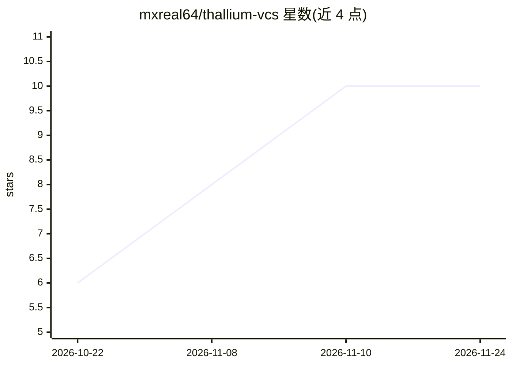

# mxreal64/thallium-vcs

⭐ 10 · F# · MPL-2.0 · 推送 2026-09-30 · [GitHub](https://github.com/mxreal64/thallium-vcs) · 个人维护

**面向自主编码 Agent 的 AI 原生版本控制系统**

为 AI 编码 Agent 设计的版本控制系统：提供微秒级写时复制沙箱隔离多 Agent 并发写入、原子事务提交账本、类型化意图标签与 Agent 来源元数据（模型、token），内置策略引擎限制 Agent 对敏感路径的写入，并支持并行锦标赛评测候选方案后自动提交胜者。通过 JSON-RPC 2.0 守护进程暴露沙箱、提交、历史查询等接口供 Agent 调用，可与 Git 互操作（导入/导出/克隆/双向同步），也可完全替代 Git。以 F#/C# 实现，需从源码构建。

## 筛选速览

| 维度 | 判定 | 备注 |
|---|---|---|
| AI 角色 | `ai-ecosystem` | LLM/agent 周边工具 |
| 许可风险 | `permissive` | MPL-2.0 |
| 部署形态 | `None` |  |
| 模型依赖 | — | README 未给出锁定关系 |
| 硬件要求 | — | 无带数字的原话,不猜 |
| 安装摩擦 | `medium` | 含编译或系统依赖之一 |
| 成熟度 | — | 结构信号不足 |

## 能力要点

- 写时复制微沙箱隔离多 Agent 并发写入，原子提交账本
- JSON-RPC 2.0 守护进程暴露 fetchContext/沙箱/提交等接口
- tl tournament 并行评测候选沙箱并自动提交胜者
- 内置策略引擎：保护路径、人工审批、限制删除与批量修改

## 适用场景

- 让多个 AI Agent 并行修改代码并自动评测择优提交
- 为 Agent 写入设置不可变路径与人工审批护栏
- 通过 JSON-RPC 让 Agent 以结构化方式查询与提交历史
- 在 AI 密集工作流中与 Git 互操作或替代 Git

## 场景标签

`多智能体` `编码 Agent` · 领域:Agent 开发

## 证据(README 行号)

> L4:  AI-Native Version Control System
> L286: Thallium is not "Git but better." It's a **programmable VCS substrate** — the diff, merge, tournament, policy, and

## 星数曲线

2026-10-22 6 → 2026-11-24 10（+4）

---
*卡片 v1 · prompt 1.4 · 生成 2026-11-19 · 置信度 high · 依据 README sha `73ff88435994` · [字段定义](../../DATASET.md)*
