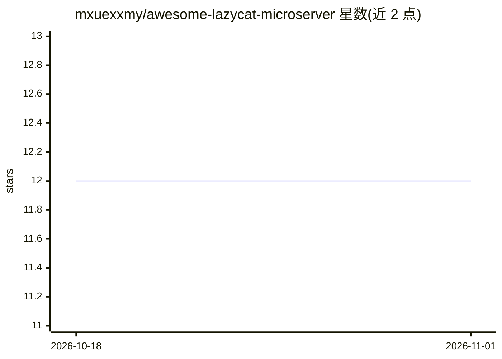

# mxuexxmy/awesome-lazycat-microserver

⭐ 12 · CC0-1.0 · 推送 2026-10-19 · [GitHub](https://github.com/mxuexxmy/awesome-lazycat-microserver) · 个人维护 · 中文 README

**懒猫微服资源策展清单：教程、工具与非官方整合**

面向懒猫微服（LazyCat Microserver）用户的非官方 awesome 清单，收录社区教程（80+ 篇专栏、上手评测、LPK 应用开发指南）、工具与集成（lazycat-mcp MCP 桥接本地 LLM、lazycat-skills、应用定时调度）、以及多篇用户使用体验文章。设备本体为家庭私有云一体机，含 NAS、应用商店、远程访问与本地 AI 算力（AI Pod）。清单条目以中文内容为主，兼有英文硬件评测。

## 筛选速览

| 维度 | 判定 | 备注 |
|---|---|---|
| AI 角色 | `ai-knowledge` | 知识聚合/清单类 |
| 许可风险 | `viral` | CC0-1.0 |
| 部署形态 | `library` | 以包/库形式分发 |
| 模型依赖 | — | README 未给出锁定关系 |
| 硬件要求 | — | 无带数字的原话,不猜 |
| 安装摩擦 | `low` | 无编译、无系统依赖或容器化 |
| 成熟度 | — | 结构信号不足 |

## 能力要点

- 收录社区教程、工具集成与用户体验三类资源
- lazycat-mcp 将懒猫硬件与本地 LLM 通过 MCP 桥接
- lazycat-skills 提供 Cursor/Claude 的 Agent Skills
- 覆盖 LPK 应用打包开发与 Docker 引擎接管等进阶主题

## 适用场景

- 入手懒猫微服后查找配置与应用开发教程
- 为 Cursor/Claude 安装懒猫相关 Agent Skills
- 了解社区的非官方移植与工具生态

## 场景标签

`精选清单` `教程课程` · 领域:学习与行业

## 证据(README 行号)

> L1: # Awesome LazyCat Microserver Awesome
> L5: > A home private-cloud appliance with NAS features, an application marketplace, remote-access tooling, and local AI 
> L9: ## Contents

## 星数曲线

2026-10-18 12 → 2026-11-01 12（+0）

---
*卡片 v1 · prompt 1.4 · 生成 2026-11-01 · 置信度 mid · 依据 README sha `026a84a2be46` · [字段定义](../../DATASET.md)*
