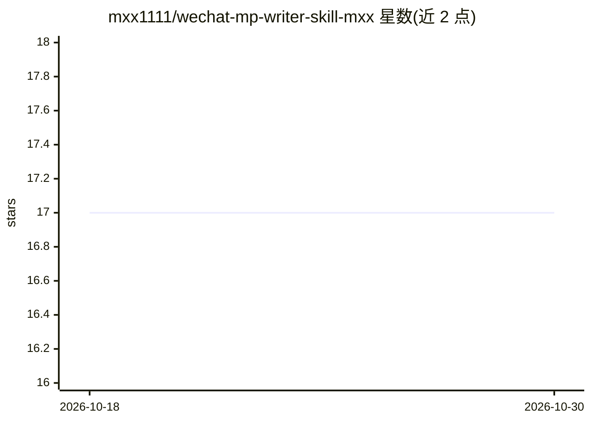

# mxx1111/wechat-mp-writer-skill-mxx

⭐ 17 · Python · MIT · 推送 2026-08-24 · [GitHub](https://github.com/mxx1111/wechat-mp-writer-skill-mxx) · 个人维护 · 中文 README

**公众号写作发布 Skill：Markdown 转公众号 HTML 并发布前体检**

面向 Claude Code / OpenClaw 的微信公众号写作 Skill：提供排版模版库（政策白皮书、长期照护简报、技术干货），用统一 CLI 把 Markdown 编译为内联样式的 HTML，绕开公众号编辑器剥离 style 标签的限制；并在发布前执行体检，检查外链不可点、标题超长、摘要缺失、代码超宽等平台约束问题。数值限制集中存于 platform-limits.json 并带核对日期。仅依赖 Python 标准库，写作与去 AI 味委托给其他专门 skill。

## 筛选速览

| 维度 | 判定 | 备注 |
|---|---|---|
| AI 角色 | `ai-ecosystem` | LLM/agent 周边工具 |
| 许可风险 | `permissive` | MIT |
| 部署形态 | `None` |  |
| 模型依赖 | — | README 未给出锁定关系 |
| 硬件要求 | — | 无带数字的原话,不猜 |
| 安装摩擦 | `low` | 无编译、无系统依赖或容器化 |
| 成熟度 | — | 结构信号不足 |

## 能力要点

- Markdown 编译为内联样式 HTML，适配公众号编辑器限制
- 发布前体检：外链、标题、摘要、代码宽度等规则检查
- 数值限制集中在 platform-limits.json，含 lastVerified 与陈旧度检查脚本
- 仅依赖 Python 标准库，体检可脱离 skill 单独使用

## 适用场景

- 把 Markdown 稿件排版成可直接粘贴公众号编辑器的 HTML
- 群发前自动检查文章是否踩平台限制
- 给 AI 写作助手接入公众号发布工作流

## 场景标签

`AI 写作` · 领域:内容生成

## 证据(README 行号)

> L3: **公众号排版模版 + 发布前体检。** 把 Markdown 编译成可直接粘进公众号编辑器的 HTML，并在发那一下之前把会翻车的地方查出来。
> L105: |`SKILL.md`|流程编排|

## 星数曲线

2026-10-18 17 → 2026-10-30 17（+0）

---
*卡片 v1 · prompt 1.4 · 生成 2026-10-29 · 置信度 high · 依据 README sha `40cac632df89` · [字段定义](../../DATASET.md)*
