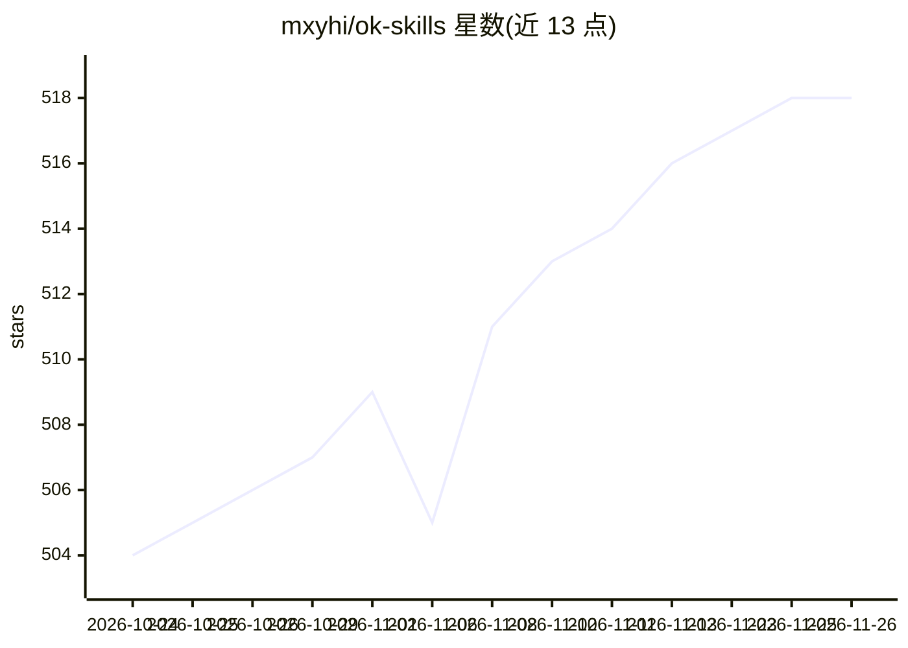

# mxyhi/ok-skills

⭐ 518 · HTML · Apache-2.0 · 推送 2026-11-20 · [GitHub](https://github.com/mxyhi/ok-skills) · 个人维护 · 中文 README

**为 AI 编码 agent 提供的 33 个技能与 AGENTS.md 模板集合**

以 git clone 方式安装到 ~/.agents/skills 的技能集合仓库，收录 33 个顶层技能目录与一份 CLAUDE_AGENTS.md 播种文件，适配 Codex、Claude Code、Cursor、OpenClaw 等 SKILL.md 兼容工具。技能按研究与文档、规划与提示、自动化与 QA、前端设计、工具与写作分类，多数技能从上游仓库 vendored 并跟踪上游迁移说明。运行前提包括 gh 认证、Chrome/CDP 环境等，逐个 SKILL.md 说明。

## 筛选速览

| 维度 | 判定 | 备注 |
|---|---|---|
| AI 角色 | `ai-knowledge` | 知识聚合/清单类 |
| 许可风险 | `permissive` | Apache-2.0 |
| 部署形态 | `None` |  |
| 模型依赖 | — | README 未给出锁定关系 |
| 硬件要求 | — | 无带数字的原话,不猜 |
| 安装摩擦 | `low` | 无编译、无系统依赖或容器化 |
| 成熟度 | — | 结构信号不足 |

## 能力要点

- 33 个可复用技能目录，clone 后即符合 AGENTS.md 布局
- CLAUDE_AGENTS.md 提供 Claude Code/Codex 全局指令播种文件
- 技能按研究与文档、规划、自动化 QA、前端设计等用例分类
- vendored 技能带上游基线与迁移说明（版本化更新记录）

## 适用场景

- 给 Codex/Claude Code 等编码 agent 添加文档查询、浏览器自动化等现成技能
- 跨项目复用 CLAUDE.md/AGENTS.md 工作流指令
- 查找 SKILL.md 实际示例作为编写参考

## 场景标签

`提示工程` `浏览器自动化` · 领域:Agent 开发

## 证据(README 行号)

> L7: Curated AI coding agent skills and `CLAUDE.md` / `AGENTS.md` playbooks for Codex, Claude Code, Cursor, OpenClaw, Aut
> L9: This repo currently bundles **33 reusable skills**, all maintained as top-level skill directories in this repo. Clon

## 星数曲线

2026-10-24 504 → 2026-11-26 518（+14）

---
*卡片 v1 · prompt 1.4 · 生成 2026-11-25 · 置信度 high · 依据 README sha `fe692f506d05` · [字段定义](../../DATASET.md)*
