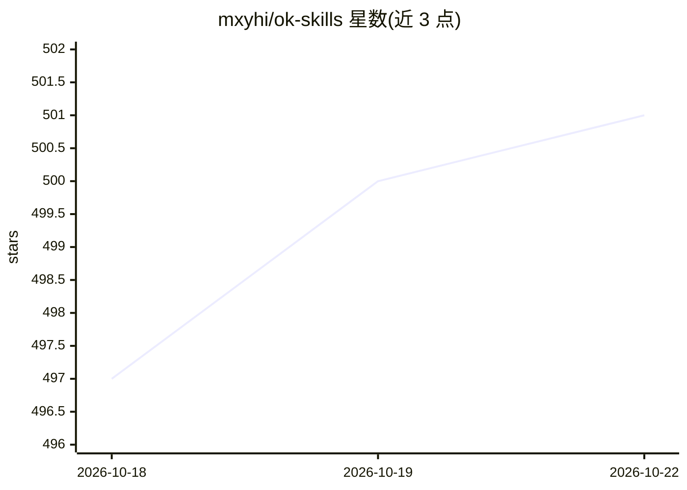

# mxyhi/ok-skills

⭐ 501 · HTML · Apache-2.0 · 推送 2026-10-18 · [GitHub](https://github.com/mxyhi/ok-skills) · 个人维护 · 中文 README

**面向 Codex/Claude Code 等编码 agent 的技能与 AGENTS.md 剧本策展库**

策展型 AI 编码 agent 技能仓库：收录 32 个 SKILL.md 格式的可复用技能与 CLAUDE.md/AGENTS.md 剧本，供 Codex、Claude Code、Cursor、OpenClaw、Autohand Code、Trae 等 SKILL.md 兼容工具使用。技能覆盖文档查询、浏览器自动化、规划工作流、前端设计、PDF/Office 排版等场景，部分技能标注上游来源（vendored）。安装方式为 git clone 到 ~/.agents/skills 或 ~/.autohand/skills 目录；部分技能依赖 gh CLI、Chrome/CDP 环境或外部 CLI/MCP 工具。

## 筛选速览

| 维度 | 判定 | 备注 |
|---|---|---|
| AI 角色 | `ai-knowledge` | 知识聚合/清单类 |
| 许可风险 | `permissive` | Apache-2.0 |
| 部署形态 | `None` |  |
| 模型依赖 | — | README 未给出锁定关系 |
| 硬件要求 | — | 无带数字的原话,不猜 |
| 安装摩擦 | `low` | 无编译、无系统依赖或容器化 |
| 成熟度 | — | 结构信号不足 |

## 能力要点

- 收录 32 个按用例分类的可复用 SKILL.md 技能
- 提供 CLAUDE_AGENTS.md 剧本可合并进 CLAUDE.md/AGENTS.md
- 技能索引标注 vendored 技能的上游来源 URL
- 附上游迁移说明跟踪技能版本变化

## 适用场景

- 为我的编码 agent 添加文档查询、浏览器自动化、规划等技能
- 跨项目复用 CLAUDE.md/AGENTS.md 工作流配置
- 查找适用于 Codex/Claude Code/Cursor 的 SKILL.md 示例

## 场景标签

`提示工程` `精选清单` · 领域:Agent 开发

## 证据(README 行号)

> L7: Curated AI coding agent skills and `CLAUDE.md` / `AGENTS.md` playbooks for Codex, Claude Code, Cursor, OpenClaw, Aut
> L9: This repo currently bundles **32 reusable skills**, all maintained as top-level skill directories in this repo. Clon

## 星数曲线

2026-10-18 497 → 2026-10-22 501（+4）

---
*卡片 v1 · prompt 1.4 · 生成 2026-10-21 · 置信度 high · 依据 README sha `7e89636d8162` · [字段定义](../../DATASET.md)*
