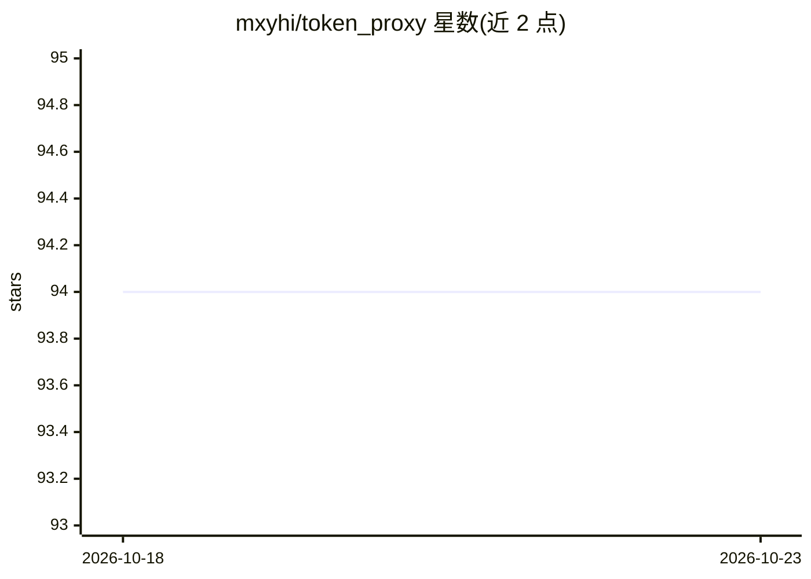

# mxyhi/token_proxy

⭐ 94 · Rust · Apache-2.0 · 推送 2026-10-19 · [GitHub](https://github.com/mxyhi/token_proxy) · 个人维护 · 中文 README

**本地 AI API 网关：聚合多家上游并计量 token**

Rust + Tauri 实现的本地 API 网关，支持 openai / openai-response / anthropic / gemini / kiro / codex / xai 七种上游 provider，以 upstream 为唯一调度单位，提供优先级负载均衡、串行/对冲/竞速分发策略、模型别名映射、可选的跨格式转换（OpenAI Chat⇄Responses、Anthropic↔OpenAI、Gemini↔OpenAI/Anthropic，含 SSE/工具/图像）以及 SQLite 记录的请求与 token 用量面板。macOS 提供托盘应用（含实时 token 速率），另发布各平台 CLI 二进制；Kiro/Codex/xAI 需以账户凭据绑定。默认端口 9208。

## 筛选速览

| 维度 | 判定 | 备注 |
|---|---|---|
| AI 角色 | `ai-ecosystem` | LLM/agent 周边工具 |
| 许可风险 | `permissive` | Apache-2.0 |
| 部署形态 | `None` |  |
| 模型依赖 | locked-api |  |
| 硬件要求 | — | 无带数字的原话,不猜 |
| 安装摩擦 | `low` | 无编译、无系统依赖或容器化 |
| 成熟度 | — | 结构信号不足 |

## 能力要点

- 7 种上游 provider，优先级负载均衡与串行/对冲/竞速分发
- OpenAI Chat⇄Responses、Anthropic↔OpenAI、Gemini↔OpenAI/Anthropic 跨格式转换（含 SSE/工具/图像）
- SQLite 统计请求、token、缓存 token 与延迟的面板
- 模型别名映射（精确/prefix*/通配*）与本地访问密钥隔离上游凭据

## 适用场景

- 本地统一入口管理多家 AI API 密钥并按优先级调度
- 让 Claude Code / Codex 等客户端通过网关调用不同上游
- 跨格式转换以用 OpenAI 兼容客户端访问 Anthropic/Gemini
- 查看各上游的 token 消耗与延迟统计

## 场景标签

`模型网关` · 领域:Agent 开发

## 证据(README 行号)

> L5: Local AI API gateway for OpenAI / Gemini / Anthropic. Runs on your machine, keeps tokens counted (SQLite), offers pr
> L10: - Multiple providers: `openai`, `openai-response`, `anthropic`, `gemini`, `kiro`, `codex`, `xai`
> L11: - Built-in routing + optional format conversion (OpenAI Chat ⇄ Responses; Anthropic Messages ↔ OpenAI; Gemini ↔ Ope

## 星数曲线

2026-10-18 94 → 2026-10-23 94（+0）

---
*卡片 v1 · prompt 1.4 · 生成 2026-10-23 · 置信度 high · 依据 README sha `b4eb1b5639e0` · [字段定义](../../DATASET.md)*
