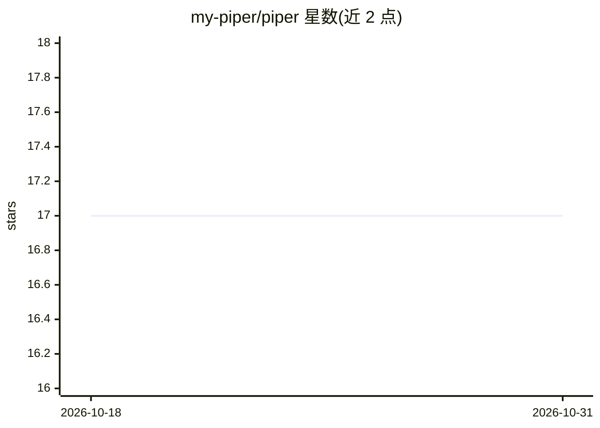

# my-piper/piper

⭐ 17 · TypeScript · MIT · 推送 2026-10-30 · [GitHub](https://github.com/my-piper/piper) · [官网](https://piper.my) · 组织维护

**面向高负载项目的可视化 AI 流水线编辑器与运行平台**

提供拖拽式可视化画布，用于设计、测试与部署 AI 流水线：可将多个 AI 模型作为节点连接编排，在 playground 中交互运行与批量执行，并一键将流水线发布为 API（自动生成端点、限流）。流水线采用开放 YAML 规范定义，支持运行时 JavaScript 自定义节点、导入导出与可复用节点包管理。自托管部署文档尚未完成，当前可参考 Docker Swarm 配置；本地开发需 Docker Desktop、Node.js 22 与 golang-migrate，经 git clone 子模块、make 脚本与 npm 命令启动后端、worker 与前端，数据层使用 MongoDB 与 ClickHouse。

## 筛选速览

| 维度 | 判定 | 备注 |
|---|---|---|
| AI 角色 | `ai-ecosystem` | LLM/agent 周边工具 |
| 许可风险 | `permissive` | MIT |
| 部署形态 | `None` |  |
| 模型依赖 | — | README 未给出锁定关系 |
| 硬件要求 | — | 无带数字的原话,不猜 |
| 安装摩擦 | `medium` | 含编译或系统依赖之一 |
| 成熟度 | `idea` | |

## 能力要点

- 可视化画布拖拽编排多模型节点，无需写代码
- 流水线一键发布为 API（自动生成端点、限流）
- 开放 YAML 流水线规范，支持导入导出与节点包复用
- 运行时用 JavaScript 创建/修改自定义节点

## 适用场景

- 用可视化编辑器编排多模型的 AI 工作流
- 把设计好的 AI 流水线直接发布为可调用的 API
- 在 playground 中调试输入并批量执行流水线
- 团队共享可复用的自定义节点包

## 场景标签

`工作流自动化` · 领域:效率与自动化

## 证据(README 行号)

> L7: Build and automate AI pipelines with an intuitive visual editor.
> L13: Drag and drop AI models onto a visual canvas to design powerful workflows. Connect nodes, customize settings, and s
> L33: ## Deploy pipelines as API

## 星数曲线

2026-10-18 17 → 2026-10-31 17（+0）

---
*卡片 v1 · prompt 1.4 · 生成 2026-10-29 · 置信度 high · 依据 README sha `dbfe400f88ef` · [字段定义](../../DATASET.md)*
